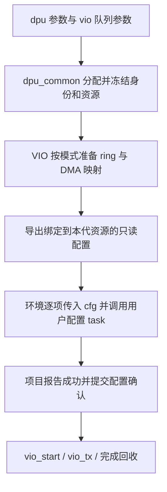

# VIO 外部设备配置接入：Packed 与自定义队列共享分配、配置和运行流程

日期：2026-11-07

状态：设计稿，待用户审阅。本文新增的类型、接口和参数尚未实现；现有源码行为不变。

本次修订纳入后续要求：项目仅使用外部设备配置流程；导出所有身份、BAR、队列、
中断和表项信息；逐类预留用户 task；用户 task 可直接复用 `pcie_work` 访问 DUT。
队列数按队列对计数，32 对表示 32 条 TX 和 32 条 RX。支持显式选择轮询或 MSI-X。
最新接口约定：每个用户 task 只接收一个完整的配置记录，用户只实现单项写法；
环境根据冻结后的实际条目集合，统一控制遍历、配置顺序和失败处理。

## 1. 已确认的需求

用户要求由 `dpu_common` 管理 Host、PF/VF、BDF、BAR 和队列资源分配，
显式指定 VIO 的队列数量、大小和模式，并从这些分配结果获得实际 DUT 配置所需的信息。
VIP 跳过前期与 DUT 的发现、复位、协商及寄存器配置；项目自己的 task/sequence
取得同一份配置后，主动设置 BAR、VTX/VRX、QSCH 等，随后通过 VIO 控制发包。

用户只需为每类配置编写一次通用 task。qid、BAR 基址、ring 地址、模式及中断等
信息封装为该 task 的一个输入配置记录；环境负责为所有需要配置的项生成记录并
逐项调用。用户无需在 test 中手写 Host/PF/VF/队列循环，也无需为每个 qid 写 task。

用户已进一步确认：本次使用 **Packed ring，TX 数据包含标准 `virtio_net_hdr`
和 Ethernet 报文**。沿用现有 SG/descriptor chain 表达 header 与 payload，
不额外要求二者在 Host 内存中物理连续。

用户随后要求同时覆盖现有自定义模式 `VQ_CUSTOM`。两种模式共用本地准备、
外部设备配置、提交确认和发包接口，保留各自的描述符、完成和报文格式。
标准 Packed 的报文头要求不扩展到自定义模式：当前自定义数据路径不带
`virtio_net_hdr`，它通过私有 descriptor 字段传递控制信息。

继续采用一个项目 `env extends uvm_env` 和一个 `env_cfg`，直接组合 DPU、PCIe TL
及各 Host 的 VIO；不新增项目 env 继承层。默认传输仍是已有 Intel PCIe bind，
每 Host 一组接口，同 Host 的 PF/VF 共享接口。参数保持 `dpu.*`、`vio.*`、
`pcie_cfg.*`；`integration/` 仍是独立参考，不进入生产 filelist/package。

成功标准是：准备阶段没有 VIP 发起的设备配置访问；项目读取的配置与实际 ring、
DMA 映射和 notify 完全一致；项目完成配置前不能提交报文；完成配置后能够通过
既有发包命令运行，并分别正确处理 Packed 完成或私有 CQ，回收对应资源。

## 2. 项目仅保留外部设备配置接入

项目 env 固定采用“准备→导出→环境遍历调用用户 task→确认→发包”，不再提供选择标准
主动初始化的项目参数。删除原项目 `configure_device()`、base_test 对它的调用、
默认寄存器计划 executor 的安装，以及对应自动配置的 Tcl 命令入口。

项目命令面保留 `vio_start/vio_tx/vio_wait_rx/vio_stop` 和用户自己注册的配置 sequence；
不注册 `vio_init/vio_reset/vio_set_mq/vio_set_rss` 来间接恢复原配置流程。
用户需要复位或改变队列时显式执行自己的设备 task，再使用资源生命周期接口。

删除范围是当前项目接入链路的主动配置编排；DPU 的分配/查询/编码、PCIe 读写
以及其他独立标准驱动测试使用的公共实现保持各自职责。项目不会选择旧的自动
配置协议。尤其不能把 PCIe 访问能力一起删掉：它是用户 task 写 DUT 的底层通道。

本地准备不能靠改变 FSM 公共字段或伪造寄存器读写成功完成。DPU env 可以在
`executor=null` 时解析并发布快照；项目只负责绑定给用户使用的 PCIe 访问接口，
不安装自动执行寄存器计划的调用链。



## 3. 配置来源与所有权

| 信息 | 唯一来源 | 项目取得后的用途 |
| --- | --- | --- |
| Host、segment、PF/VF 身份、service key、BDF | DPU device snapshot | Function 路由、BDF 和身份表设置 |
| 各 BAR 的角色、BAR 编号、base、size | DPU device snapshot 的 BAR 租约 | 配置硬件 BAR，确定 MMIO 窗口 |
| virtio pair、本地 RX/TX qid、全局 qpair、local/global MSI-X 映射 | DPU resource snapshot | VTX/VRX 索引、notify/qid 映射及 QSCH 关联 |
| 本次启用的 pair 数、队列深度、队列格式、方向及协议配置 | 已加载并冻结的 VIO service 配置 | 配置有效队列集合与设备数据面行为 |
| Packed 的 desc/event 区，或自定义 desc/CQ 的 GPA/IOVA、长度 | VIO 实际内存分配和映射结果 | 将设备可见 IOVA 写入队列寄存器 |
| notify BAR、最终字节 offset、写宽度与数据编码 | 项目显式提供的通知配置，结合 DPU BAR 租约校验 | VIP 发出准确的通知 |
| MSI-X Table/PBA 布局、Message Address/Data、mask、队列到向量映射 | 平台中断配置与 DPU 分配结果，在本地统一校验/冻结 | 用户配置设备，VIP 绑定相同的中断接收规则 |
| QSCH 的 TC、端口、权重等调度策略 | 项目在准备前提供的 cfg，或显式调用的 DPU 纯策略生成能力 | 用户 task 消费同一份策略配置调度，不由 VIO 队列层决定 |

BAR 地址是设备的 MMIO 地址。ring 的 GPA 属于 Host 内存，IOVA 是设备 DMA 地址；
三者分别导出，项目必须用 IOVA 配置设备 DMA，不能默认 GPA 与 IOVA 数值相等。

若用户需要固定 BAR 地址，应在 DPU snapshot 冻结前通过原有 BAR request 设置
`DPU_ALLOC_PINNED` 和 base。VIO 继续消费解析结果，不再增加独立的 BAR base 参数。

现有 DPU 绑定明确区分 `virtio_pair_index`、`local_pair_id` 和 `global_qpair_id`。
标准 profile 中 pair p 的 RX/TX 本地 qid 为 `2*p`、`2*p+1`；两方向消费同一个
全局 qpair。项目不得用本地 qid 或 `qid >> 1` 替代快照给出的全局编号。

队列 owner 与配置寄存器的访问目标分别记录。VF 队列的 notify 可以位于 VF BAR，
而 VTX/VRX、BDF、MSI-X 映射及 QSCH 全局表可能通过 AF BAR 访问。导出完整 AF
身份和 BAR，并在每个表项中携带实际访问目标，不根据队列 owner 猜测寄存器位置。

## 4. 本地准备与导出的配置对象

拟新增 `vio_external_setup` 只读视图，汇总本次选择的 service，每个 service 包含：

- 完整身份、BAR 租约和所引用的冻结快照身份。
- 请求及实际启用的队列对数、方向、队列格式、深度、feature 或私有控制配置。
- 每对队列的本地/全局映射，以及每条实际准备队列的 ring GPA/IOVA、长度。
- 各模式的初始索引和 wrap 状态、明确的通知地址与编码。
- Packed 明确导出 driver/device event 地址；自定义明确导出 CQ 地址、格式、
  有效长度和可用 descriptor 数，不能让项目把 CQ 误解为 Packed event 区。
- 轮询或 MSI-X 完成模式、向量映射、PCI MSI-X Table/PBA 和 DPU 中断相关表项。
- 本次准备代号、已准备/已确认状态；外部只通过查询方法取得值副本。

视图不拥有 ring。ring、payload、DMA 映射仍由 VIO ops/queue manager 管理，
项目不释放这些内存。修改返回的副本不得改变实际队列或已冻结视图。

准备阶段必须完成所有本地检查和分配，不执行 PCIe Config Read/Write、
设备 MMIO Read/Write 或 notify。初始化 ring 时写 Host 模型内存是允许的。
队列深度必须明确且非零；外部模式不能沿用 `queue_size=0` 的“读取设备上限”语义。

准备接口拆分现有 `setup_queue` 中的本地资源准备与设备编程：

1. 检查 service/Host/BAR/队列资源和能力声明。
2. 按模式创建队列，分配并映射 ring，按对应协议初始化内容、索引和 wrap。
3. 保存实际 queue program 与资源所有权，导出配置视图。
4. 等待项目显式完成设备配置，之前禁止 dataplane 提交和通知。

标准模式的原 `setup_queue` 继续组合本地准备、标准设备配置和激活，保持原行为。
不通过给标准后端添加“假成功”的 MMIO 接口实现外部模式。

### 4.1 Packed 与自定义模式的格式差异

| 项目 | 标准 Packed：`VQ_PACKED` | 现有自定义：`VQ_CUSTOM` |
| --- | --- | --- |
| TX 数据 | `virtio_net_hdr` 和 Ethernet payload | Ethernet payload，不带 `virtio_net_hdr` |
| 描述符 | 标准 Packed descriptor，16 字节 | DPU 私有 W1/W2 descriptor，16 字节；字段语义不同 |
| 完成 | Packed descriptor 的 USED/wrap | 私有 CQ |
| Host ring | descriptor 区和两份 4 字节 event 区 | 连续 desc + CQ，整块按 4096 字节对齐分配 |
| TX CQ | 无独立 CQ | desc 后的 2 字节 head/wrap |
| RX CQ | 无独立 CQ | desc 后的 N 个 16 字节 CQ 项 |
| 可用容量 | 按现有 Packed 分配规则 | N 个 descriptor 槽保留一个，最多 N-1 个在途 descriptor |
| 深度约束 | 现有 Packed 几何检查及项目声明能力 | 2..4096 范围内的 2 次幂 |
| 控制信息 | 标准 header 与声明的 features | `dport_info/dport_id/dport_type/cpu_tx_cos/fwd/rss_lag/l3_cs/l4_cs` 等私有字段 |
| 通知 | 显式选择标准 16/32 位编码 | DPU 固定 32 位 `{wrap[31], tail[30:16], local_qid[15:0]}` |

自定义 TX 的有效 ring 字节数为 `16*N + 2`，RX 为 `32*N`，分配长度向上取整到
4096 字节边界。CQ 的设备可见地址由整块 ring 的实际 IOVA 与偏移计算并导出，
不能单独按另一个地址规则分配。现有自定义 TX CQ 初值为 `16'h8000`；RX CQ 清零，
索引为零且初始 wrap 为一。准备过程复用这些协议初始化规则，不能统一清零后
直接开放发包。

项目固定由用户配置设备；`queue_type` 选择数据格式，与配置所有权无关。
新外部协议必须按 service 安装相符的 queue 和配置后端，允许不同 service 使用
不同格式；同一个 service 内本次保持单一格式，冻结后不能原地切换。

目前的 `virtio_function_instance` 是根据是否存在 `private_cfg` 选择私有协议，
所以仅设置 `vio.queue_type=VQ_CUSTOM` 不会自动获得完整的私有协议。
外部模式应根据最终队列类型创建/校验匹配的私有配置并绑定，复用
`dpu_priv_driver_config` 的参数和 descriptor 控制逻辑，但不复用其设备初始化。

现有 `dpu_priv_config_backend` 在 discover、configure_queue、enable_queue、reset
中访问 DUT；其配置面仅实现 AF 路径，并以 `local_qid >> 1` 推导部分全局队列/向量。
外部模式不调用这些步骤。全局 qpair 和 MSI-X 映射全部来自 DPU snapshot，
项目负责按真实 Host/PF/VF 配置设备，因此不能把原 AF 模型测试当作新模式的
多 Host/PF/VF 支持证明。

自定义本地 qid 仍需满足现有 u8、方向和唯一性约束，并与 snapshot 一致。
旧 `local_qid_base`/单队列覆盖若与冻结绑定冲突，应在准备前报错；不在另一层
重新分配身份。通知编码使用本地 qid，全局 qpair 单独交给项目配置硬件映射。

### 4.2 可逐项查询的数据记录

导出对象提供 `list_functions()`、`list_qpairs()`、`list_tx_queues()`、
`list_rx_queues()`、各类 `list_*_entries()` 和按完整 key 查询的方法。
每条队列记录包含 owner key；外部即使只遍历扁平队列列表，也能找到唯一 Function。
返回值副本，不能通过修改视图把已分配队列改挂到另一个 PF/VF。

| 记录 | 必须导出的字段 |
| --- | --- |
| Function | Host、segment、PF/VF kind、PF ID、VF ID、所属 service key 集合、BDF、global function ID、source ID、RC slot |
| BAR | Function key、角色、实际 BAR 编号、64 位 base、size、64 位 BAR 对的配置空间位置和属性 |
| Qpair | service key、virtio pair index、placement local pair、global qpair、RX/TX local qid、local/global MSI-X vector |
| 每条 TX/RX 队列 | Function owner、service key、方向、格式、深度、实际可用槽数、desc/event/CQ 的 GPA/IOVA/长度、初始索引/wrap、RX buffer 大小、notify 信息、向量引用 |
| 表项访问位置 | 目标 Function/Host/segment/BDF、BAR 编号和基址、字节 offset、绝对 MMIO 地址、访问宽度、表索引、布局是否已提供、本次是否必需、表项 valid 值 |
| 中断项 | Message Address、Message Data、table slot、全局/本地 vector、消费该 vector 的队列集合、mask、启用状态 |

每条 queue 是一份配置记录，但它会引用共享的 Function/BAR/qpair/vector 记录。
共享表项去重后单独列出：一个 BDF 项只按 Function 配置一次，一个 MSI-X 项只按
实际向量配置一次。对 32 对队列不能盲目重复配置 64 份相同 BAR/BDF/MSI-X 项。

交给用户 task 的记录同时包含它需要的共享信息值副本。例如，VTX 的单个 cfg
包含队列 owner、实际管理寄存器访问目标、qid、BAR 基址和 ring 地址，用户无需
再传一个 AF 对象或在 task 中按 qid 查找全局 env_cfg。附带共享字段是为了单项
配置方便；环境仍按每类表自己的集合调度，不在每个 VTX task 中重复配置 BDF/BAR。

Function 列表覆盖 DPU 已创建的身份，并标出 AF 和实际承载 VIO 的 service。
表项没有布局与表项需要写入 `valid=0` 是两件事：前者不能发起访问，后者仍可能
是清理 shadow bank 的必需写操作。记录必须明确区分，不能用一个 valid 位混用。

BAR 基址既可由 DPU 分配，也可在解析前明确指定。按当前参数格式，固定 VF0
BAR0 的输入为 `dpu.h0.pf0.vf0.bar0.placement=DPU_ALLOC_PINNED` 和
`dpu.h0.pf0.vf0.bar0.base=<基址>`；BDF 用同路径下 `bdf_mode/bdf` 指定。
实际地址必须满足对应 DUT BAR profile 的大小和对齐，导出时保留真实解析结果。

### 4.3 32 对队列的归属与显式指定

一个 VIO service 的所有队列属于它的一个 PF 或一个 VF。32 对集中在一个 service
时，对号为 0..31，RX local qid 为 0,2,...,62，TX 为 1,3,...,63；global qpair
编号仍取实际分配结果，不保证等于对号。该 Function 的 BAR 由所有这些队列共享。

`vio.pairs=32` 是所有选中 service 的缺省值，不表示将全项目总共 32 对自动均分。
若要 VF0 16 对、VF1 16 对，应分别指定两个 service 的需求；若要仅一个 VF 有
32 对，应明确选择该 VF，不让其他已创建 Function 也获得默认业务队列。

拟增加 `vio.enabled` 的全局/Host/service 覆盖，项目在 DPU placement 冻结前读取：
`vio.enabled=0` 加 `vio.h0.pf0.vf0.i0.enabled=1` 表示只为 VF0 的 i0 创建本次业务。
它只选择 VIO service，不删除 PF/VF 身份对象。每个启用 service 独立创建固定目标
placement request，按最终 `pairs` 精确申请；取消原先一个 request 按最大默认
pairs 给所有候选统一预留的做法。既有 DPU request 覆盖不自动与新生成器混用，
显式自定义 authoring 与数量生成器只能选择一种入口，以免两套需求相互覆盖。

以下是更新后参考环境的目标参数示例，其中 `enabled` 属于拟新增参数：

```text
+dpu.hosts=1
+dpu.pfs_per_host=1
+dpu.vfs_per_pf=1
+vio.enabled=0
+vio.h0.pf0.vf0.i0.enabled=1
+vio.h0.pf0.vf0.i0.pairs=32
+vio.h0.pf0.vf0.i0.queue_type=VQ_PACKED
+vio.h0.pf0.vf0.i0.queue_size=512
```

若需要固定该 VF 的 BDF/BAR，使用已有输入，示例地址位于参考 Host0 的 MMIO
窗口内；其他固定 BAR 仍需由 resolver 校验互不重叠：

```text
+dpu.h0.pf0.vf0.bdf_mode=DPU_ALLOC_PINNED
+dpu.h0.pf0.vf0.bdf=0x0011
+dpu.h0.pf0.vf0.bar0.placement=DPU_ALLOC_PINNED
+dpu.h0.pf0.vf0.bar0.base=0x0000002080000000
+dpu.h0.pf0.vf0.bar4.placement=DPU_ALLOC_PINNED
+dpu.h0.pf0.vf0.bar4.base=0x0000002081000000
```

该例中 AF 位于 PF0，32 对业务队列属于 VF0。当前 DPU 每 Function 上限为 32 对，
而 AF 的 11 对额外队列也计入同一上限，因此默认 AF 最多容纳 21 对普通 VIO 队列。
不能在默认 AF 上直接申请 32 对普通队列。选择普通 VF 或非 AF PF 才能在现有
能力范围内集中申请 32 对；总量仍受全局 qpair、notify bank 和 MSI-X 容量限制。
不得为了让例子通过而静默修改真实能力或取消 AF 额外资源。

AF 额外队列/中断资源在导出对象中单独分类，供用户配置相关表，不伪装成 VF0
service 的 32 对业务队列，也不在没有数据面配置时给它们虚构 ring 地址。

### 4.4 轮询、MSI-X 地址与运行方式

沿用 `vio.completion_mode=VIRTIO_COMPLETION_POLLING` 或
`VIRTIO_COMPLETION_MSIX`，补齐精确 service 级覆盖。项目默认轮询，显式选择后
冻结；不做自适应切换，不自动修改 DUT 中断 mask，不降级为 INTx。

- 轮询：按配置间隔检查 Host 的 Packed USED 或私有 CQ，不要求 DUT 发中断。
  仍导出 DPU 分配的向量与映射信息，设备是否要求配置某些内部中断字段由用户
  task 决定；VIP 不据此宣称 PCI MSI-X 已启用。
- MSI-X：本地导入已声明的向量、Message Address/Data 和队列映射，用户配置
  设备表项与使能，确认后通过 Intel/PCIe monitor 捕获实际 MSI-X Memory Write
  唤醒对应队列完成处理。超时报告缺失中断，不能靠轮询兜底让中断测试通过。
- 共享向量：允许一对 RX/TX 或多个 pair 引用同一向量，接收后处理其全部队列。
  不假定 64 条 RX/TX 队列就需要 64 个向量，也不私自占用 vector 0 做 config 中断。

MSI-X 必须区分三种地址：

1. **Table 地址**：设备 BAR base + table offset + local table slot * 16。
   导出 address low/high、data、vector control 所在位置。
2. **PBA 地址**：设备 BAR base + PBA offset，以及对应 pending bit/长度。
   PBA 是 pending 状态信息，不能把它当成普通初始化表让用户循环写零。
3. **Message Address**：DUT 发往 Host 的中断目的地址，独立于设备 BAR 和 ring IOVA。
   Message Data 也显式导出，不能用它的低位重新猜测 local/global vector。

平台提供 Table/PBA 的 BAR、offset、table size 和需要的 MSI-X capability 控制
位置，因为本流程不执行 capability 发现；准备阶段只做边界/身份校验。
Message Address/Data 可以由平台逐向量设置，也可用显式 base/stride 模板生成，
生成结果与 Host 中断接收匹配表使用同一份冻结值。

拟新增 `vio.msix.table_bar/table_offset/table_size/pba_bar/pba_offset/cap_offset`、
`vio.msix.msg_addr_base/msg_addr_stride/msg_data_base/msg_data_stride` 和逐向量
覆盖；平台已经有中断配置对象时可以通过 cfg 直接注入。MSI-X 模式下缺布局或
地址/数据时失败，轮询模式下可将 PCI MSI-X 布局标为未提供。

`table_size` 表示实际表项数；逐向量覆盖路径为 `vio.msix.vN.msg_addr/msg_data/masked`，
N 是该 Function 的 local vector/table slot，支持相同的 Host/service 前缀。
模板按 `base + local_vector * stride` 计算，逐向量值优先；检查地址/数据位宽、
Table/PBA 对齐与范围、占用槽位和布局重叠。同一 Function 内多个 service 的
共享布局和向量设置必须一致，不能因 service 级覆盖而把同一表项导出两种值。

同 Host/segment 的不同 Function 不能使用有歧义的接收匹配项。不同 Host 的相同
BDF 或 Message Address/Data 必须由实际 RC/Host 域隔离。观察器按已配置项匹配
并返回该项的向量身份，不限制成固定 APIC 地址，也不通过 Requester ID 或 data
低位猜测未知消息。此规则仅用于新外部协议，不改变其他独立传统场景的含义。

准备阶段建立本代本地接收规则，先于用户使能设备中断；消息使用可保留的计数或
待处理状态，避免早到消息因 worker 尚未等待而丢失。READY 前不提交报文或回收
队列。共享向量的 service 必须使用相容的完成模式；轮询不能替其他 service
消费中断状态。DPU 的 self-mask 字段照常导出；若用户启用自动屏蔽，重新使能由
用户运行期 task/sequence 明确执行，VIP 不隐式写回，连续中断验证必须覆盖此流程。

DPU AF 管理窗口中的全局 MSI-X 表与 Function 的 PCI MSI-X Table 分别保留访问
视图。若实际 DUT 将两者映射到同一存储，平台显式声明这种对应关系，由环境
调度入口根据该声明选择写入视图；不能默认它们独立，也不能重复写入
相互冲突的消息或 mask。

目前私有配置路径强制 polling，标准 TX worker 也包含周期轮询，通知管理器会
在配置和 mask/unmask 中写设备。因此 MSI-X 接入是本次必须实现并验证的完整
路径，不能只注册一个枚举参数或复用 `setup_msix()` 的设备写操作。

## 5. 项目 env / test 的拟用法

下面仅说明拟新增接口及调用顺序，不是当前可编译的示例：

```systemverilog
// build/connect 仍由现有 env/cfg 完成；先确保平台复位与 DMA 服务可用。
prepare_platform();

// 拟新增：只在本地准备资源，返回只读配置和明确结果。
env.prepare_vio_resources(setup, ok, why);
if (!ok) begin
    `uvm_fatal("VIO_PREPARE", why)
end

// 拟新增的环境统一入口：遍历 setup 中的实际配置项，逐项调用用户 hook。
// 用户只填写每类 hook 内部如何写 DUT；全部循环由环境实现。
env.configure_vio_dut(setup, ok, why);
if (!ok) begin
    `uvm_fatal("DUT_CONFIG", why)
end

// 拟新增：校验同一份配置和同一代资源，记录项目已完成设备配置。
// 此接口不重新访问 DUT，也不宣称独立验证了硬件寄存器值。
env.commit_vio_configuration(setup, ok, why);
if (!ok) begin
    `uvm_fatal("VIO_COMMIT", why)
end

env.register_aip_commands();
aip_tcl_bridge::run_loop();
finish_platform();
```

`setup`、`ok`、`why` 的声明属于调用 task；实际实现使用 extern 和宽松排版。
项目的 sequence 也可以调用同一个 `configure_vio_dut()`，再通过已有 AIP 机制
注册；它不需要重新实现遍历。配置的具体执行位置不改变
“准备→环境遍历调用用户方法→确认→发包”的依赖。

原 `env.configure_device()` 从项目参考中删除，用户迁移后不再调用它。
DPU 的分配、冻结快照及纯表项生成/寄存器编码能力继续供项目显式使用。

### 5.1 用户配置 task 清单

以下均为拟在 `project_env.sv` 中提供的 `extern virtual task`。实现置于同文件
类外，保持中文职责注释和宽松排版。每个 task 仅有一个用于配置的输入参数 cfg，
其类型按 Function、队列或表项区分，里面包含该项所需的全部身份、地址与逻辑值。
`output bit ok, output string why` 仅用于返回结果，不属于额外配置输入。
未实现的必需 hook 默认返回失败，不把空 task 当作硬件配置成功。

`configure_vio_dut()` 的完整遍历由环境提供；build/connect 不会调用它，运行阶段
由 test 或已注册的配置 sequence 显式调用一次。用户填写下面每类方法的单项
写法即可，不接管总入口的循环。环境只调用本次适用的 hook：未启用方向不配置
其运行队列；轮询且未提供 PCI MSI-X 布局时不调用对应 Table/PBA hook。
必需性在导出时明确检查，不能以
空列表或未实现 hook 返回成功掩盖缺失配置。一个必需 hook 失败立即停止后续使能
和提交，保留资源供用户停止设备后清理。

| task | 单个 cfg 的配置粒度与信息 |
| --- | --- |
| `user_prepare_device` | 整个 setup：平台复位、必要的全局初始化及配置前条件 |
| `user_configure_pcie_function` | 每 Function：BDF、PF/VF、BAR base/size、PCI Command 和平台要求的 Function 使能信息 |
| `user_configure_af` | AF/Host：AF 身份、管理 BAR、AF 声明和 Host 选择信息 |
| `user_configure_bdf_entry` | 每有效 Function：global function ID → BDF、valid、实际 AF 表地址 |
| `user_configure_msix_linear_entry` | 每唯一映射：source ID + local vector → global vector、valid、表地址 |
| `user_configure_msix_info_entry` | 每 global vector：Host、Function、valid/self-mask、表地址 |
| `user_configure_msix_interval_entry` | 每 global vector：中断间隔/包数策略、表地址 |
| `user_configure_msix_control_entry` | DPU 全局中断控制/消息存储视图：global vector、控制字段、实际访问地址 |
| `user_configure_msix_table_entry` | 每 PCI MSI-X table slot：Message Address/Data、Vector Control、BAR/offset |
| `user_configure_msix_function` | 每 Function：MSI-X enable、Function Mask、明确的配置空间位置；传入轮询/MSI-X 模式 |
| `user_check_msix_pba` | 可选状态检查：PBA BAR/offset、向量对应 pending bit；不是普通写表 hook |
| `user_configure_notify_entry` | 每 bank/table slot：本地 pair 编码、Host、notify address、global qpair、type、valid；包含需要清除的无效项 |
| `user_commit_notify_bank` | 整个 bank：bank 编号、commit 位置和数据、需要的完成检查 |
| `user_initialize_qsch` | 整个 QSCH：初始化所需的实际平台策略和已分配队列集合 |
| `user_configure_qsch_q2tc` | 每有效队列映射项：global qpair、TC、net 等逻辑值及表索引 |
| `user_configure_qsch_n2g` | 每唯一 N2G 项及目标地址 |
| `user_configure_qsch_g2p` | 每唯一 G2P 项及目标地址 |
| `user_configure_qsch_spwrr` | 每唯一 SP/WRR 策略项及目标地址 |
| `user_configure_qsch_tc_weight` | 每唯一 TC weight 项及目标地址 |
| `user_configure_vtx_queue` | 每启用 TX：owner、global qpair、格式/深度、desc/event/CQ IOVA、向量等 |
| `user_configure_vrx_queue` | 每启用 RX：同上，并包含 RX buffer 大小、目的 Function/Host 信息 |
| `user_configure_queue_aux` | 每 qpair：平台额外 context/tail/list-table 等配置所需身份和 ring 信息 |
| `user_enable_queue` | 每启用 TX/RX：在相关表和地址配置完成后执行设备使能 |
| `user_verify_configuration` | 整个 setup：读回、状态等待及最终配置成功判定 |
| `user_quiesce_device` | 整个 setup：明确停止设备 DMA，为释放/重配提供真实结果 |
| `user_reset_device` | 整个 setup：由用户显式调用的设备复位，不在错误恢复中自动触发 |

表清单对照当前 bootstrap/VIO register plan、dataplane extension 和私有后端。
原先未完整自动实现的 context/tail/list-table 也预留 hook，但未知寄存器地址和
平台语义由用户填入，不生成虚构配置。QSCH 的 TC/port/group/weight 可以由项目
cfg 或准备前显式调用的 DPU topology generator 提供，生成结果只作为导出数据。
用户 task 负责实际寄存器打包和访问，不能另行修改与已导出队列绑定冲突的策略。

notify 表中的 local pair 编码与 doorbell 的 RX/TX local virtqueue ID 分别传入。
沿用现有 DPU 编码时，要保留其 128 字节通知窗口对齐、字段位宽和排序约束；
逐队列 notify 绑定必须能由所选硬件表布局表示，否则准备阶段报错。用户已知的
active bank 或目标 bank 由配置输入提供，准备阶段不读 DUT 来自动猜测。

推荐调用依赖为：平台准备→Function/BAR→AF/BDF→MSI-X/notify 映射→QSCH/
VTX/VRX/辅助上下文→设备使能→读回确认。环境维护这个阶段顺序；项目有特殊
硬件顺序时调整同一调度入口的阶段安排，单项 task 不承担外围循环。
PCI MSI-X 表项修改遵循屏蔽后写地址/数据、再按目标 mask/enable 生效的顺序，
最终由用户 task 执行。PBA 只作为状态位置导出，不写入通用初始化序列。

### 5.2 用户 task 直接调用 PCIe 访问能力

拟提供以下 env 方法，不要求用户自己构造 TLP：

| 接口 | 输入与底层实现 |
| --- | --- |
| `pcie_cfg_read/write` | 目标 Function、配置空间字节 offset、数据/byte enable；复用 `pcie_tl_cfg_rd_seq/pcie_tl_cfg_wr_seq` |
| `pcie_bar_read/write` | 目标 Function、BAR 编号、BAR 内字节 offset、4/8/12/16 字节长度、128 位数据和字节 skip mask；复用 `pcie_tl_reg_seq` |
| `pcie_poll_bar` | 在上述 BAR read 上执行有限次数/时间的用户条件轮询；mask/value 明确区分于字节 skip mask |

所有方法返回 `ok/why`，读方法另返回数据。完整 Function key 解析出 Host、segment、
BDF；`{Host,segment}` 选择已绑定的 RC sequencer，BAR write 使用实际
`bar.base + offset` 形成 Memory TLP。配置空间 TLP 通过 BDF 路由；Memory TLP
通过地址路由，不能把两种访问混为一谈。随后仍走既有 PCIe TL → Intel adapter
→ bind wrapper → DUT，不引入 SVT 或建链流程。

地址和宽度在发包前检查 BAR 边界、64 位溢出、对齐、4KB 边界及 Host 映射。
缺 Host/segment 路由时必须报错，不回退 Root0。`pcie_tl_reg_seq` 的 mask 是
“1 跳过该字节”，用户接口明确命名为 `byte_skip_mask`，缺省 0 为全字节访问。
posted MMIO write 成功表示请求已发送；用户的 verify/poll hook 负责确认 DUT 生效。

下面说明用户 task 的填入位置和调用方式，类型及 env 方法仍是拟新增接口：

```systemverilog
// 类内声明：只传一个 cfg，包含队列自身以及实际寄存器访问目标的信息。
// 用户仅实现一个 TX 队列的配置；环境为每条启用 TX 调用本 task。
extern virtual task user_configure_vtx_queue(
    input vio_queue_setup_t	cfg,
    output bit			ok,
    output string		why
);

// 类外实现：按 cfg.global_qpair_id 选择 DUT 表项，按 cfg.desc_iova 配置 DMA。
// 实际寄存器 offset 和编码由项目填写；未填写或任一步访问失败都返回失败。
task project_env::user_configure_vtx_queue(
    input vio_queue_setup_t	cfg,
    output bit			ok,
    output string		why
);
    ok  = 0;
    why = "请在本 task 填入项目 VTX 配置";

    // 填写后的典型调用为：
    // pcie_bar_write(cfg.target.function_key, cfg.target.bar_id,
    //                项目定义的寄存器字节偏移, 4,
    //                cfg.desc_iova[31:0], 0, ok, why);
    // 随后继续写高地址、深度/模式，每一步都检查 ok。
    // cfg.target.bar_base 为管理窗口基址；helper 会执行 base + offset。
endtask
```

BAR/Mailbox/MSI-X 地址全部来自 setup，并装入对应 cfg。`cfg.owner` 是队列所属
Function，`cfg.target` 是本项配置实际访问的 Function/BAR，可以是 AF；两者由
准备阶段明确绑定，接口不偷偷重定向，也不把控制表地址当成 ring DMA 地址。

### 5.3 一个配置记录与环境统一遍历

这里的“一个参数”指 task 的一个完整输入记录，不是把所有配置塞进一个命令行
字符串。命令行仍用已有 dpu/vio/pcie_cfg 字段表达规格，环境解析并分配后产生
具体记录。采用有明确类型的记录，便于用户在 task 中直接访问字段并由编译器
检查拼写；不引入字符串字段查询或按 qid 手工拼接长参数列表。

以 `vio_queue_setup_t cfg` 为例，单个输入至少提供以下内容；未适用字段有明确
有效标志，例如 Packed 不提供私有 CQ，Custom 不提供 Packed event 区。

| cfg 内容 | 用途 |
| --- | --- |
| `generation`、`owner`、`service_key` | 标识本代资源及真实 Host/PF/VF/BDF 归属 |
| `target.function_key/bar_id/bar_base/bar_size` | 指定本 task 写 DUT 所走的 Host/RC 和管理 BAR 窗口 |
| `virtio_pair_index`、`local_pair_id`、`local_virtqueue_id`、`global_qpair_id` | 分别提供本地和全局编号，硬件表索引取其实际定义的字段 |
| `direction`、`queue_type`、`queue_size`、`usable_slots` | 控制单个队列的格式、深度和容量 |
| `desc_iova`、对应 GPA/长度、event/CQ 地址与有效标志 | 配置真实 ring DMA 区域 |
| 初始 index/wrap、RX buffer 大小及私有控制字段 | 配置该模式的数据面初态 |
| `notify` 子记录 | owner BAR、最终 notify 地址/offset、宽度和数据编码 |
| `completion_mode`、`msix` 子记录 | 轮询/MSI-X 选择、向量及关联消息地址/数据 |

用户写 `user_configure_vtx_queue(cfg, ok, why)` 一次，环境对每条已准备 TX 传入
各自 cfg；VRX、BDF、MSI-X、QSCH 等同样逐类复用各自的一份实现。用户方法只
操作当前项；需要多个寄存器写入时可以在内部顺序执行，向外报告整项结果。

环境从冻结视图查询真实记录集合，不重新按 `pairs` 拼 qid，也不假定全局编号
连续。以下是环境负责的 VTX 阶段示意，仍属于拟实现接口：

```systemverilog
// 类内声明：这是环境的内部阶段，用户填写的是上面的单队列 hook。
// 输入为本次冻结视图；任一条失败即停止，并保留错误队列身份。
extern protected task configure_vtx_stage(
    input vio_external_setup	setup,
    output bit			ok,
    output string		why
);

// 类外实现示意：只遍历已准备且启用的 TX，TX 关闭时此集合为空。
// 本阶段成功不代表整机配置完成，后续仍需其他阶段、验证及最终提交。
task project_env::configure_vtx_stage(
    input vio_external_setup	setup,
    output bit			ok,
    output string		why
);
    vio_queue_setup_t	queue_cfgs[$];
    bit			item_ok;
    string		item_why;

    ok  = 0;
    why = "";

    setup.list_tx_queues(queue_cfgs);

    foreach (queue_cfgs[index]) begin
        item_ok  = 0;
        item_why = "";

        user_configure_vtx_queue(queue_cfgs[index], item_ok, item_why);

        if (!item_ok) begin
            why = $sformatf(
                "VTX item=%0d local_qid=%0d global_qpair=%0d: %s",
                index,
                queue_cfgs[index].local_virtqueue_id,
                queue_cfgs[index].global_qpair_id,
                item_why
            );
            return;
        end
    end

    ok = 1;
endtask
```

正式实现的诊断还应包含完整 Host/segment/Function/service key、准备代号和阶段。
开启某 VF 的 32 对且 TX/RX 都启用时，VTX hook 调用 32 次、VRX hook 调用 32 次，
各自收到不同的 local qid、global qpair 和真实 ring 地址。BDF/BAR 按 Function
集合配置，MSI-X 按去重向量/表项集合配置，QSCH 按各表实际项配置；AF 额外资源
仍单独处理。用户不因改变队列数量而修改 task 或遍历代码。

环境为每次配置保存本代各阶段的成功结果；统一入口禁止同一代并发执行，不自动
重试已发出的设备写。所有必需项成功且用户最终 verify hook 通过后，才标记
本代可提交。中途失败立即返回，`commit_vio_configuration()` 不得将其置为 READY。
在独立 sequence 中直接调用某个 hook 可用于调试，但不会绕过统一入口的完成检查。

## 6. 参数安排

参数定义继续放在拥有字段的原类中，`load_params()` 与字段一同维护。

| 参数/设置 | 当前状态 | 外部模式安排 |
| --- | --- | --- |
| `dpu.hosts`、`dpu.pfs_per_host`、`dpu.vfs_per_pf` | 已有项目参考入口 | 保持；资源身份由 DPU 解析 |
| `dpu.hN.pfN[.vfN].barN.placement/base` | 已有 BAR request 入口 | 固定地址时在解析前设置，不在 VIO 重复注册 |
| `vio.pairs` | 已有 | 表示队列对数，不是 RX+TX 的队列总数 |
| `vio.enabled` | 拟新增 | 在冻结前选择全局/Host/精确 service 的业务启用状态 |
| `vio.queue_type` | 已有 | 本次外部模式支持 `VQ_PACKED` 和 `VQ_CUSTOM`，选择完整匹配的数据协议 |
| `vio.queue_size` | 已有 | descriptor 数量；外部模式必须显式为有效非零深度 |
| `vio.features` | 已有 | Packed 外部模式作为项目已配置的能力合约；自定义模式的标准 Virtio features 为零 |
| 初始化方式 | 项目固定 | 由用户 task 配置 DUT，不增加 `vio.init_mode` 让项目回到旧主动配置流程 |
| `vio.tx_enable`、`vio.rx_enable` | 拟新增 | 明确运行方向；两者不能同时关闭；单 VTX 用例可关闭 RX |
| `vio.completion_mode` | 已有全局/Host 入口 | 轮询/MSI-X 显式选择，补齐精确 service 覆盖和两种格式的实际运行路径 |
| `vio.msix.*` | 拟新增 | Table/PBA/capability 位置、Message Address/Data 模板及逐向量覆盖 |
| `vio.notify_bar` | 拟新增 | 实际 BAR 编号，必须存在于该 Function 的 DPU BAR 租约 |
| `vio.notify_base`、`vio.notify_stride` | 拟新增 | BAR 内字节 offset 和队列步长，生成每条队列的最终 offset |
| `vio.notify_encoding` | 拟新增 | Packed 使用 `VIO_NOTIFY_QID16` / `VIO_NOTIFY_DATA32`；自定义使用 `VIO_NOTIFY_DPU32` |
| `vio.private.*` | 已有配置类参数入口 | 复用私有 descriptor 控制、RX buffer 大小及逐队列覆盖；外部模式补齐按 service 的自动加载和绑定 |

项目参考固定安装外部配置协议，支持固定轮询与 MSI-X 完成模式。
所有地址、表项和队列需求都在资源交付前冻结，不因运行期改变 AIP 参数表而
静默重新分配或重写设备。包数、包长、发包队列等运行期激励参数继续按命令采样。

VIO 全局、Host 和精确 service 的参数覆盖沿用现有解析顺序。
精确 service 路径继续为 `vio.hN.pfN[.vfN].iN.*`。
项目在生成 DPU placement 输入前，应消费最终队列需求，保证 service 级覆盖得到
相应资源；冻结后不能通过更改 VIO 参数扩大资源。若用户显式限制 DPU 容量而
需求超出，则在本地检查时报错，不裁剪或重新编号。

Packed 固定使用标准 Virtio header；自定义固定沿用无 Virtio header 的协议，
不增加任意组合的报文头开关。Packed 可采用 VERSION_1 与 RING_PACKED 的最小
能力合约，其余 offload/MQ 等能力按实际项目配置显式声明。声明能力不代表
新模式自动执行控制队列命令；未实现的数据面能力必须拒绝。

自定义模式的标准 Virtio features 取零，私有 descriptor 控制字段单独生效。
全局标准默认 features 不应意外被复制成自定义能力；显式给自定义 service
指定非零标准 feature 合约应报错。复用普通 TX 和单 buffer RX 数据格式，补齐
外部协议下的 MSI-X 驱动完成路径；不增加 TSO、间接 descriptor、RX 多 buffer 或迁移。

外部模式以解析后的 `vio.queue_size` 为实际深度，并同步到私有配置默认值；
若用户显式同时提供不同的 `vio.private.queue_size`，则报错而不静默取其中一个。
私有 notify 配置与通用通知输入先统一解析为每队列的最终绑定；显式重复指定
不同值时拒绝，避免配置 task 与实际 doorbell 使用两套地址。没有显式提供的
私有默认零值不能覆盖已经提供的通知配置。

notify 的数据格式与报文 header 独立。项目必须给出最终通知布局，不能仅凭
`VQ_PACKED` 推断。接口支持逐队列绑定，基础地址/步长仅用于显式生成这些绑定；
没有明确布局时准备失败，不猜测 BAR0/offset0。标准 16 位 qid 通知与 32 位
notification-data 编码按实际 feature/通知合约校验；自定义 DPU32 不依赖标准
Virtio notification feature 位。三者按模式分别校验，越界或不一致立即拒绝。

参数生成规则为 `offset = notify_base + local_virtqueue_id * notify_stride`，
使用宽整数检查溢出、访问宽度和 BAR 边界。stride 为零表示共享 doorbell 地址，
允许这种明确设置。非线性映射通过配置类的逐队列设置接口提供；与参数模板同时
存在时，逐队列设置优先，冻结后导出每条队列的最终值。base 为零本身合法，
“没有提供布局”和“明确提供零 offset”必须区分。通知数据来自运行时的本地
qid/index/wrap，不从全局 qpair 编号重新推算。

## 7. 运行与生命周期

生命周期为“未准备→已准备→已导出待配置→已确认 READY→RUNNING”。
提交确认必须校验视图来源、准备代号、全部目标 service、队列和 DMA 映射完整性。
还必须检查统一配置入口记录的本代完成结果。用户配置及最终 verify task 的成功
表示平台报告已配置并可接受 DMA；VIP 不自行读取寄存器证明这一点。

现有 `vio_start` 和 `vio_tx` 保留状态检查。通过受保护的外部确认入口完整设置
有效队列数量、能力及运行策略，再进入 READY；不能只修改 `fsm.state`。
启动时仅对启用方向创建 worker，RX 关闭时不预填 RX buffer、不发送 RX notify。

新模式运行期间：

- Packed 使用标准描述符与 `virtio_net_hdr`；自定义使用私有描述符和 CQ。
  两者共用 payload DMA 所有权及完成回收流程，保留各自格式处理。
- notify 直接使用导出的绑定；不重新读取 common-config 或 PCI capabilities。
- 不启动标准 net-config/status 轮询、自动 Function reset、标准 MQ/RSS 控制任务
  或自适应中断配置。误调用这些入口应失败，不能悄悄进入标准初始化。
- `vio_stop` 停止 VIP 提交与后台任务，不等同于硬件已经停止 DMA。
- 只有项目报告 DUT 已停 DMA/复位完成后才能释放已交付的 ring 与映射。
- 已导出配置后的失败、部分硬件配置失败、取消或超时，不自动释放可能被 DUT
  使用的内存。保留本代资源，要求项目处理设备并显式确认停止后清理。
- 设备复位使旧确认失效；旧视图不能再次提交，需要重新准备和配置新一代资源。

拟新增 `release_vio_resources(setup, dut_quiesced, ok, why)` 供平台停机后调用。
它检查准备代号、VIP worker 已停止和平台提供的停 DMA 成功结果，再回收本代资源。
`dut_quiesced` 必须来自项目的设备停止/复位流程，VIP 不代替项目验证这个外部事实。
释放后撤销 AIP 的可运行状态，重新准备产生新的代号。

未交付给项目、且设备从未获得地址的本地分配失败可以回滚。各 service 不允许
跨 Host 串用视图或内存；一个全局配置提交只在所有目标都通过检查后开放发包。

## 8. 预计修改位置

| 位置 | 修改职责 |
| --- | --- |
| `virtio_net_vip/src/env/virtio_net_env_config.sv` | 外部协议的方向、通知和 MSI-X 输入字段，启用选择及精确 service 参数复制/校验 |
| `virtio_net_vip/src/types/virtio_net_types.sv` | 必要的通知/配置视图值类型，保持公共旧类型兼容 |
| `virtio_net_vip/src/agent/virtio_atomic_ops.sv` 及队列实现 | 分离本地 ring 准备、设备编程、激活，保存 DMA 所有权 |
| `virtio_net_vip/src/agent/virtio_driver_protocol.sv` 及新增外部协议实现 | 外部配置路径的能力与生命周期约束，不改变标准协议 |
| `virtio_net_vip/src/transport/virtio_config_backend.sv` 及新增外部后端实现 | 使用显式 notify 绑定；拒绝隐含设备配置访问 |
| `virtio_net_vip/src/transport/virtio_notification_manager.sv` | 本地导入 MSI-X 表与共享向量映射，外部协议不通过本管理器写 mask 或设备表 |
| `virtio_net_vip/src/transport/virtio_pcie_observer_adapter.sv` | 按实际配置的地址/数据/Host 识别 MSI-X，使用匹配项身份唤醒队列 |
| `virtio_net_vip/src/agent/virtio_auto_fsm.sv` | 增加受保护的配置确认与运行策略入口，按协议约束 worker、监控和恢复 |
| `virtio_net_vip/src/sriov/virtio_function_instance.sv` | 按 service 安装协议/后端，导出同一身份与资源的配置 |
| `virtio_net_vip/src/dpu_priv/dpu_priv_driver_config.sv` 及私有协议接入 | 复用参数解析、队列几何和控制字段，将外部数据协议与原 AF 寄存器配置路径分开 |
| 拟新增 `virtio_net_vip/src/env/vio_external_setup.sv`，以及 `virtio_net_env.sv` | 冻结并查询实际配置，提供 service 级准备/确认/释放接口 |
| `integration/project/project_env_cfg.sv` | 统一消费队列需求并生成 DPU 输入，参考模式选择 |
| `integration/project/project_env.sv`、`project_base_test.sv` | 删除旧主动配置流程；提供统一遍历调度、单配置记录用户 task、PCIe 访问助手及准备/确认/释放流程 |
| `integration/aip/virtio_aip_pkg.sv` | 沿用 target/pair 发包入口，项目仅注册业务命令，正确区分两种完成模式 |
| 相关测试、`docs/aip_parameters.md`、项目 README/完整代码文档 | 验证参数、配置视图、数据路径并说明新的使用方式 |

DPU 已有 `get_service_owner/get_pcie_id/get_bar` 和
`list_vio_bindings_for_service/get_vio_binding_by_service_virtio_pair` 等查询接口。
优先复用，不计划为本功能修改 DPU 分配算法或 PCIe TL/Intel 驱动。
必要的 VIO 核心源码进入 VIO 自己的包；项目参考仍通过独立 filelist 显式选择。

## 9. 验证要求

实现后在 `ubuntu@10.11.10.53` 的 VCS 环境验证，加载其 VCS/license shell 环境。

1. 记录真实传输访问，证明准备和确认阶段没有 DUT 配置读写或 notify。
2. 一个 Host/一个 Function/一个 pair 的 Packed TX：512 字节测试报文，核对
   `virtio_net_hdr` 与报文字节、descriptor 长度、notify 地址/编码和完成回收；
   长度约定按现有 packet 接口解释，不能把 512 字节报文和额外 Virtio header 混算。
3. 真实生成的 ring IOVA 与导出值一致，包含非 identity IOMMU 映射用例。
4. 多 Host 使用相同数值 BDF，多 PF/VF 使用不同 BAR；验证资源与 RC slot 不串用。
5. 本地 pair 与非连续全局 qpair 不同，验证项目得到真实映射，通知无错误重编号。
6. 方向关闭、配置未确认、旧代视图、跨 service 视图、非法深度/offset/能力组合
   均明确失败；单 VTX 测试不发出 RX notify。
7. 准备失败可回滚；配置导出后部分失败必须保留资源；停止任务不提前释放 DMA；
   经项目停机确认后才能回收并开始下一代。
8. 运行一段时间仍无隐含 status/common-config 轮询或自动复位访问。
9. 独立标准驱动回归保持通过；项目 AIP 只暴露业务命令，不能通过旧初始化/复位
   命令触发设备配置；生产入口没有引入 integration。
10. 自定义 TX 的 512 字节报文不含 Virtio header，CQ 完成能正确回收 DMA；
    自定义 RX 按私有 CQ 长度交付报文。验证 N-1 容量、环回绕、TX CQ 初值和
    RX CQ wrap，并核对导出的 CQ IOVA/大小与实际连续映射一致。
11. 自定义模式同样覆盖多 Host/PF/VF 和非连续全局 qpair，不能依赖 AF0、
    `gq=local_qid>>1` 或 `gfid=0`。混合 Packed/Custom service 不串协议配置；
    自定义准备/确认/运行无旧私有后端的初始化或自动停队寄存器访问。
12. 单 VF 32 对和两个 VF 各 16 对分别验证队列记录及归属；默认 AF 请求 32 对
    普通队列明确失败，错误指出额外资源与每 Function 容量限制。
13. 逐类检查用户 task 收到的数据与原表项定义：BDF、MSI-X linear/info/interval/
    control/table、notify bank/commit、QSCH 和 VTX/VRX；共享项去重，AF 额外项
    单列。必需 hook 未填写时不能进入 READY，未提供布局不产生有效假地址。
14. 用户 hook 经 PCIe cfg/MEM sequence 实际到达 Intel 路径；验证 BDF、Host/RC、
    BAR base+offset、4/8/12/16 字节及 mask 语义，越界/缺路由在发 TLP 前失败。
    验证 posted 写与读回确认的区别，配置空间 Completion 错误向上传递。
15. Packed/Custom 分别覆盖轮询和 MSI-X。MSI-X 测试写完成状态而不发送消息时
    必须超时，发送真实匹配的 MSI-X Memory Write 后才处理完成；不得被轮询兜底。
16. MSI-X 消息地址不在旧硬编码 APIC 区、Message Data 低位不等于向量号仍按
    注册项正确路由；共享向量处理全部关联队列。跨 Host 相同地址/数据可隔离，
    同域有歧义的匹配项被拒绝，不匹配消息不唤醒错误 Function。
17. MSI-X/PBA、ring DMA 和 BAR 地址各自独立，导出不访问设备；环境统一配置循环
    不把 PBA 当成可写初始化表，也不触发隐含 MSI-X mask/read-modify-write。
18. 使能后早到的中断不丢失；跨代资源不消费旧待处理状态。共享 Function 的布局
    和向量冲突明确失败；启用 self-mask 的测试由用户重新使能后收到下一次中断。
19. 用户只提供一次各类单项 hook 实现，环境在一个 VF 32 对时分别调用 VTX/VRX
    32 次；TX-only 不调用 VRX 配置。每次传入的 cfg 含完整身份/地址，非连续全局
    qpair、多 Host 和共享表项均按真实记录遍历，不重复配置共享项。
20. 注入中途 hook 失败时，后续使能/提交被阻止，报告完整目标身份并保留资源；
    不自动重试已发写操作。单独调用一个 hook、旧代成功记录或并发配置均不能
    绕过整代完成检查；修改输入记录副本不改变冻结状态和实际 ring 绑定。

定向模型验证证明接入合同和 VIP 行为；用户实际 DUT 的寄存器语义、QSCH 和线侧
收发仍由项目联合测试验证，不以结构或模型测试代替真实 DUT 的验收。
