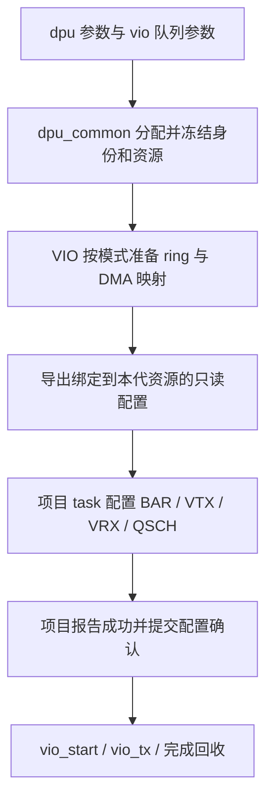

# VIO 外部设备配置接入：Packed 与自定义队列共享分配、配置和运行流程

日期：2026-11-07

状态：设计稿，待用户审阅。本文新增的类型、接口和参数尚未实现；现有源码行为不变。

## 1. 已确认的需求

用户要求由 `dpu_common` 管理 Host、PF/VF、BDF、BAR 和队列资源分配，
显式指定 VIO 的队列数量、大小和模式，并从这些分配结果获得实际 DUT 配置所需的信息。
VIP 跳过前期与 DUT 的发现、复位、协商及寄存器配置；项目自己的 task/sequence
取得同一份配置后，主动设置 BAR、VTX/VRX、QSCH 等，随后通过 VIO 控制发包。

用户已进一步确认：本次使用 **Packed ring，TX 数据包含标准 `virtio_net_hdr`
和 Ethernet 报文**。沿用现有 SG/descriptor chain 表达 header 与 payload，
不额外要求二者在 Host 内存中物理连续。

用户随后要求同时覆盖现有自定义模式 `VQ_CUSTOM`。两种模式共用本地准备、
外部设备配置、提交确认和发包接口，保留各自的描述符、完成和报文格式。
标准 Packed 的报文头要求不扩展到自定义模式：当前自定义数据路径不带
`virtio_net_hdr`，它通过私有 descriptor 字段传递控制信息。

继续采用一个项目 `env extends uvm_env` 和一个 `env_cfg`，直接组合 DPU、PCIe TL
及各 Host 的 VIO；不新增项目 env 继承层。默认传输仍是已有 Intel PCIe bind，
每 Host 一组接口，同 Host 的 PF/VF 共享接口。参数保持 `dpu.*`、`vio.*`、
`pcie_cfg.*`；`integration/` 仍是独立参考，不进入生产 filelist/package。

成功标准是：准备阶段没有 VIP 发起的设备配置访问；项目读取的配置与实际 ring、
DMA 映射和 notify 完全一致；项目完成配置前不能提交报文；完成配置后能够通过
既有发包命令运行，并分别正确处理 Packed 完成或私有 CQ，回收对应资源。

## 2. 选择的接入方式

| 方式 | 使用方法 | 取舍 |
| --- | --- | --- |
| 显式准备、导出、外部配置、确认 | env 提供准备和确认接口，项目自由组织配置 task/sequence | 推荐；符合用户控制 DUT 配置顺序的要求，配置失败及重试边界清晰 |
| 初始化命令内部调用项目回调 | 一条初始化命令准备资源并调用项目回调 | 调用次数较少，但项目配置时序与初始化命令、取消处理耦合更紧 |

采用第一种。保留现有标准初始化模式作为独立选择，不改变它的 `vio_init` 语义。
新模式通过显式入口准备资源，不能靠改变 FSM 公共字段或伪造寄存器读写成功完成。



## 3. 配置来源与所有权

| 信息 | 唯一来源 | 项目取得后的用途 |
| --- | --- | --- |
| Host、segment、PF/VF 身份、service key、BDF | DPU device snapshot | Function 路由、BDF 和身份表设置 |
| 各 BAR 的角色、BAR 编号、base、size | DPU device snapshot 的 BAR 租约 | 配置硬件 BAR，确定 MMIO 窗口 |
| virtio pair、本地 RX/TX qid、全局 qpair、local/global MSI-X 映射 | DPU resource snapshot | VTX/VRX 索引、notify/qid 映射及 QSCH 关联 |
| 本次启用的 pair 数、队列深度、队列格式、方向及协议配置 | 已加载并冻结的 VIO service 配置 | 配置有效队列集合与设备数据面行为 |
| Packed 的 desc/event 区，或自定义 desc/CQ 的 GPA/IOVA、长度 | VIO 实际内存分配和映射结果 | 将设备可见 IOVA 写入队列寄存器 |
| notify BAR、最终字节 offset、写宽度与数据编码 | 项目显式提供的通知配置，结合 DPU BAR 租约校验 | VIP 发出准确的通知 |
| QSCH 的 TC、端口、权重等调度策略 | 项目的配置 task，或它显式调用的 DPU QSCH 能力 | 用户控制调度，不由 VIO 队列层决定 |

BAR 地址是设备的 MMIO 地址。ring 的 GPA 属于 Host 内存，IOVA 是设备 DMA 地址；
三者分别导出，项目必须用 IOVA 配置设备 DMA，不能默认 GPA 与 IOVA 数值相等。

若用户需要固定 BAR 地址，应在 DPU snapshot 冻结前通过原有 BAR request 设置
`DPU_ALLOC_PINNED` 和 base。VIO 继续消费解析结果，不再增加独立的 BAR base 参数。

现有 DPU 绑定明确区分 `virtio_pair_index`、`local_pair_id` 和 `global_qpair_id`。
标准 profile 中 pair p 的 RX/TX 本地 qid 为 `2*p`、`2*p+1`；两方向消费同一个
全局 qpair。项目不得用本地 qid 或 `qid >> 1` 替代快照给出的全局编号。

## 4. 本地准备与导出的配置对象

拟新增 `vio_external_setup` 只读视图，汇总本次选择的 service，每个 service 包含：

- 完整身份、BAR 租约和所引用的冻结快照身份。
- 请求及实际启用的队列对数、方向、队列格式、深度、feature 或私有控制配置。
- 每对队列的本地/全局映射，以及每条实际准备队列的 ring GPA/IOVA、长度。
- 各模式的初始索引和 wrap 状态、明确的通知地址与编码。
- Packed 明确导出 driver/device event 地址；自定义明确导出 CQ 地址、格式、
  有效长度和可用 descriptor 数，不能让项目把 CQ 误解为 Packed event 区。
- 本次准备代号、已准备/已确认状态；外部只通过查询方法取得值副本。

视图不拥有 ring。ring、payload、DMA 映射仍由 VIO ops/queue manager 管理，
项目不释放这些内存。修改返回的副本不得改变实际队列或已冻结视图。

准备阶段必须完成所有本地检查和分配，不执行 PCIe Config Read/Write、
设备 MMIO Read/Write 或 notify。初始化 ring 时写 Host 模型内存是允许的。
队列深度必须明确且非零；外部模式不能沿用 `queue_size=0` 的“读取设备上限”语义。

准备接口拆分现有 `setup_queue` 中的本地资源准备与设备编程：

1. 检查 service/Host/BAR/队列资源和能力声明。
2. 按模式创建队列，分配并映射 ring，按对应协议初始化内容、索引和 wrap。
3. 保存实际 queue program 与资源所有权，导出配置视图。
4. 等待项目显式完成设备配置，之前禁止 dataplane 提交和通知。

标准模式的原 `setup_queue` 继续组合本地准备、标准设备配置和激活，保持原行为。
不通过给标准后端添加“假成功”的 MMIO 接口实现外部模式。

### 4.1 Packed 与自定义模式的格式差异

| 项目 | 标准 Packed：`VQ_PACKED` | 现有自定义：`VQ_CUSTOM` |
| --- | --- | --- |
| TX 数据 | `virtio_net_hdr` 和 Ethernet payload | Ethernet payload，不带 `virtio_net_hdr` |
| 描述符 | 标准 Packed descriptor，16 字节 | DPU 私有 W1/W2 descriptor，16 字节；字段语义不同 |
| 完成 | Packed descriptor 的 USED/wrap | 私有 CQ |
| Host ring | descriptor 区和两份 4 字节 event 区 | 连续 desc + CQ，整块按 4096 字节对齐分配 |
| TX CQ | 无独立 CQ | desc 后的 2 字节 head/wrap |
| RX CQ | 无独立 CQ | desc 后的 N 个 16 字节 CQ 项 |
| 可用容量 | 按现有 Packed 分配规则 | N 个 descriptor 槽保留一个，最多 N-1 个在途 descriptor |
| 深度约束 | 现有 Packed 几何检查及项目声明能力 | 2..4096 范围内的 2 次幂 |
| 控制信息 | 标准 header 与声明的 features | `dport_info/dport_id/dport_type/cpu_tx_cos/fwd/rss_lag/l3_cs/l4_cs` 等私有字段 |
| 通知 | 显式选择标准 16/32 位编码 | DPU 固定 32 位 `{wrap[31], tail[30:16], local_qid[15:0]}` |

自定义 TX 的有效 ring 字节数为 `16*N + 2`，RX 为 `32*N`，分配长度向上取整到
4096 字节边界。CQ 的设备可见地址由整块 ring 的实际 IOVA 与偏移计算并导出，
不能单独按另一个地址规则分配。现有自定义 TX CQ 初值为 `16'h8000`；RX CQ 清零，
索引为零且初始 wrap 为一。准备过程复用这些协议初始化规则，不能统一清零后
直接开放发包。

`init_mode` 决定由谁配置设备，`queue_type` 决定数据格式，这两项分别选择。
新外部协议必须按 service 安装相符的 queue 和配置后端，允许不同 service 使用
不同模式；同一个 service 内本次保持单一模式，冻结后不能原地切换。

目前的 `virtio_function_instance` 是根据是否存在 `private_cfg` 选择私有协议，
所以仅设置 `vio.queue_type=VQ_CUSTOM` 不会自动获得完整的私有协议。
外部模式应根据最终队列类型创建/校验匹配的私有配置并绑定，复用
`dpu_priv_driver_config` 的参数和 descriptor 控制逻辑，但不复用其设备初始化。

现有 `dpu_priv_config_backend` 在 discover、configure_queue、enable_queue、reset
中访问 DUT；其配置面仅实现 AF 路径，并以 `local_qid >> 1` 推导部分全局队列/向量。
外部模式不调用这些步骤。全局 qpair 和 MSI-X 映射全部来自 DPU snapshot，
项目负责按真实 Host/PF/VF 配置设备，因此不能把原 AF 模型测试当作新模式的
多 Host/PF/VF 支持证明。

自定义本地 qid 仍需满足现有 u8、方向和唯一性约束，并与 snapshot 一致。
旧 `local_qid_base`/单队列覆盖若与冻结绑定冲突，应在准备前报错；不在另一层
重新分配身份。通知编码使用本地 qid，全局 qpair 单独交给项目配置硬件映射。

## 5. 项目 env / test 的拟用法

下面仅说明拟新增接口及调用顺序，不是当前可编译的示例：

```systemverilog
// build/connect 仍由现有 env/cfg 完成；先确保平台复位与 DMA 服务可用。
prepare_platform();

// 拟新增：只在本地准备资源，返回只读配置和明确结果。
env.prepare_vio_resources(setup, ok, why);
if (!ok) begin
    `uvm_fatal("VIO_PREPARE", why)
end

// 项目自己实现：从 setup 获取身份、BAR、队列映射和实际 ring 地址。
// 由此配置 BAR、notify/qid 表、VTX/VRX、QSCH 等，并负责必要的硬件检查。
configure_dut_from_vio_setup(setup, ok, why);
if (!ok) begin
    `uvm_fatal("DUT_CONFIG", why)
end

// 拟新增：校验同一份配置和同一代资源，记录项目已完成设备配置。
// 此接口不重新访问 DUT，也不宣称独立验证了硬件寄存器值。
env.commit_vio_configuration(setup, ok, why);
if (!ok) begin
    `uvm_fatal("VIO_COMMIT", why)
end

env.register_aip_commands();
aip_tcl_bridge::run_loop();
finish_platform();
```

`setup`、`ok`、`why` 的声明属于调用 task；实际实现使用 extern 和宽松排版。
项目也可以把 `configure_dut_from_vio_setup` 写成自己的 sequence，再通过已有
AIP 机制注册。配置的具体执行位置不改变“准备→外部配置→确认→发包”的依赖。

外部模式下，参考 base_test 不调用原 `env.configure_device()`，以免它下发 DPU
寄存器计划。若误调用，应在执行计划前给出明确错误，而不是静默返回成功。
DPU 的分配、冻结快照及寄存器编码能力仍可供项目显式使用。

## 6. 参数安排

参数定义继续放在拥有字段的原类中，`load_params()` 与字段一同维护。

| 参数/设置 | 当前状态 | 外部模式安排 |
| --- | --- | --- |
| `dpu.hosts`、`dpu.pfs_per_host`、`dpu.vfs_per_pf` | 已有项目参考入口 | 保持；资源身份由 DPU 解析 |
| `dpu.hN.pfN[.vfN].barN.placement/base` | 已有 BAR request 入口 | 固定地址时在解析前设置，不在 VIO 重复注册 |
| `vio.pairs` | 已有 | 表示队列对数，不是 RX+TX 的队列总数 |
| `vio.queue_type` | 已有 | 本次外部模式支持 `VQ_PACKED` 和 `VQ_CUSTOM`，选择完整匹配的数据协议 |
| `vio.queue_size` | 已有 | descriptor 数量；外部模式必须显式为有效非零深度 |
| `vio.features` | 已有 | Packed 外部模式作为项目已配置的能力合约；自定义模式的标准 Virtio features 为零 |
| `vio.init_mode` | 拟新增 | `VIO_INIT_STANDARD` / `VIO_INIT_EXTERNAL`；库默认保持标准模式 |
| `vio.tx_enable`、`vio.rx_enable` | 拟新增 | 明确运行方向；两者不能同时关闭；单 VTX 用例可关闭 RX |
| `vio.notify_bar` | 拟新增 | 实际 BAR 编号，必须存在于该 Function 的 DPU BAR 租约 |
| `vio.notify_base`、`vio.notify_stride` | 拟新增 | BAR 内字节 offset 和队列步长，生成每条队列的最终 offset |
| `vio.notify_encoding` | 拟新增 | Packed 使用 `VIO_NOTIFY_QID16` / `VIO_NOTIFY_DATA32`；自定义使用 `VIO_NOTIFY_DPU32` |
| `vio.private.*` | 已有配置类参数入口 | 复用私有 descriptor 控制、RX buffer 大小及逐队列覆盖；外部模式补齐按 service 的自动加载和绑定 |

外部配置接入由项目参考显式选择，不能仅因使用 Intel 接口就自动改变初始化方式。
初期外部模式使用固定轮询完成，不启动自适应切换 MSI-X 的任务；仍导出已有
local/global MSI-X 映射供项目查询，但不宣称已经完成中断表或消息路由配置。

VIO 全局、Host 和精确 service 的参数覆盖沿用现有解析顺序。
精确 service 路径继续为 `vio.hN.pfN[.vfN].iN.*`。
项目在生成 DPU placement 输入前，应消费最终队列需求，保证 service 级覆盖得到
相应资源；冻结后不能通过更改 VIO 参数扩大资源。若用户显式限制 DPU 容量而
需求超出，则在本地检查时报错，不裁剪或重新编号。

Packed 固定使用标准 Virtio header；自定义固定沿用无 Virtio header 的协议，
不增加任意组合的报文头开关。Packed 可采用 VERSION_1 与 RING_PACKED 的最小
能力合约，其余 offload/MQ 等能力按实际项目配置显式声明。声明能力不代表
新模式自动执行控制队列命令；未实现的数据面能力必须拒绝。

自定义模式的标准 Virtio features 取零，私有 descriptor 控制字段单独生效。
全局标准默认 features 不应意外被复制成自定义能力；显式给自定义 service
指定非零标准 feature 合约应报错。复用当前私有数据路径的 polling、普通 TX 和
单 buffer RX 范围，不在本次增加 TSO、间接 descriptor、RX 多 buffer 或迁移。

外部模式以解析后的 `vio.queue_size` 为实际深度，并同步到私有配置默认值；
若用户显式同时提供不同的 `vio.private.queue_size`，则报错而不静默取其中一个。
私有 notify 配置与通用通知输入先统一解析为每队列的最终绑定；显式重复指定
不同值时拒绝，避免配置 task 与实际 doorbell 使用两套地址。没有显式提供的
私有默认零值不能覆盖已经提供的通知配置。

notify 的数据格式与报文 header 独立。项目必须给出最终通知布局，不能仅凭
`VQ_PACKED` 推断。接口支持逐队列绑定，基础地址/步长仅用于显式生成这些绑定；
没有明确布局时准备失败，不猜测 BAR0/offset0。标准 16 位 qid 通知与 32 位
notification-data 编码按实际 feature/通知合约校验；自定义 DPU32 不依赖标准
Virtio notification feature 位。三者按模式分别校验，越界或不一致立即拒绝。

参数生成规则为 `offset = notify_base + local_virtqueue_id * notify_stride`，
使用宽整数检查溢出、访问宽度和 BAR 边界。stride 为零表示共享 doorbell 地址，
允许这种明确设置。非线性映射通过配置类的逐队列设置接口提供；与参数模板同时
存在时，逐队列设置优先，冻结后导出每条队列的最终值。base 为零本身合法，
“没有提供布局”和“明确提供零 offset”必须区分。通知数据来自运行时的本地
qid/index/wrap，不从全局 qpair 编号重新推算。

## 7. 运行与生命周期

生命周期为“未准备→已准备→已导出待配置→已确认 READY→RUNNING”。
提交确认必须校验视图来源、准备代号、全部目标 service、队列和 DMA 映射完整性。
配置 task 的成功表示平台已配置并可接受 DMA；VIP 不自行读取寄存器证明这一点。

现有 `vio_start` 和 `vio_tx` 保留状态检查。通过受保护的外部确认入口完整设置
有效队列数量、能力及运行策略，再进入 READY；不能只修改 `fsm.state`。
启动时仅对启用方向创建 worker，RX 关闭时不预填 RX buffer、不发送 RX notify。

新模式运行期间：

- Packed 使用标准描述符与 `virtio_net_hdr`；自定义使用私有描述符和 CQ。
  两者共用 payload DMA 所有权及完成回收流程，保留各自格式处理。
- notify 直接使用导出的绑定；不重新读取 common-config 或 PCI capabilities。
- 不启动标准 net-config/status 轮询、自动 Function reset、标准 MQ/RSS 控制任务
  或自适应中断配置。误调用这些入口应失败，不能悄悄进入标准初始化。
- `vio_stop` 停止 VIP 提交与后台任务，不等同于硬件已经停止 DMA。
- 只有项目报告 DUT 已停 DMA/复位完成后才能释放已交付的 ring 与映射。
- 已导出配置后的失败、部分硬件配置失败、取消或超时，不自动释放可能被 DUT
  使用的内存。保留本代资源，要求项目处理设备并显式确认停止后清理。
- 设备复位使旧确认失效；旧视图不能再次提交，需要重新准备和配置新一代资源。

拟新增 `release_vio_resources(setup, dut_quiesced, ok, why)` 供平台停机后调用。
它检查准备代号、VIP worker 已停止和平台提供的停 DMA 成功结果，再回收本代资源。
`dut_quiesced` 必须来自项目的设备停止/复位流程，VIP 不代替项目验证这个外部事实。
释放后撤销 AIP 的可运行状态，重新准备产生新的代号。

未交付给项目、且设备从未获得地址的本地分配失败可以回滚。各 service 不允许
跨 Host 串用视图或内存；一个全局配置提交只在所有目标都通过检查后开放发包。

## 8. 预计修改位置

| 位置 | 修改职责 |
| --- | --- |
| `virtio_net_vip/src/env/virtio_net_env_config.sv` | 外部模式、方向及通知输入字段和参数注册，配置复制及校验 |
| `virtio_net_vip/src/types/virtio_net_types.sv` | 必要的初始化模式/通知值类型，保持旧默认兼容 |
| `virtio_net_vip/src/agent/virtio_atomic_ops.sv` 及队列实现 | 分离本地 ring 准备、设备编程、激活，保存 DMA 所有权 |
| `virtio_net_vip/src/agent/virtio_driver_protocol.sv` 及新增外部协议实现 | 外部配置路径的能力与生命周期约束，不改变标准协议 |
| `virtio_net_vip/src/transport/virtio_config_backend.sv` 及新增外部后端实现 | 使用显式 notify 绑定；拒绝隐含设备配置访问 |
| `virtio_net_vip/src/agent/virtio_auto_fsm.sv` | 增加受保护的配置确认与运行策略入口，按协议约束 worker、监控和恢复 |
| `virtio_net_vip/src/sriov/virtio_function_instance.sv` | 按 service 安装协议/后端，导出同一身份与资源的配置 |
| `virtio_net_vip/src/dpu_priv/dpu_priv_driver_config.sv` 及私有协议接入 | 复用参数解析、队列几何和控制字段，将外部数据协议与原 AF 寄存器配置路径分开 |
| 拟新增 `virtio_net_vip/src/env/vio_external_setup.sv`，以及 `virtio_net_env.sv` | 冻结并查询实际配置，提供 service 级准备/确认/释放接口 |
| `integration/project/project_env_cfg.sv` | 统一消费队列需求并生成 DPU 输入，参考模式选择 |
| `integration/project/project_env.sv`、`project_base_test.sv` | 汇总准备/确认、外部配置调用顺序和禁止重复配置 |
| `integration/aip/virtio_aip_pkg.sv` | 沿用 target/pair 发包入口，给不适用于外部模式的命令明确报错 |
| 相关测试、`docs/aip_parameters.md`、项目 README/完整代码文档 | 验证参数、配置视图、数据路径并说明新的使用方式 |

DPU 已有 `get_service_owner/get_pcie_id/get_bar` 和
`list_vio_bindings_for_service/get_vio_binding_by_service_virtio_pair` 等查询接口。
优先复用，不计划为本功能修改 DPU 分配算法或 PCIe TL/Intel 驱动。
必要的 VIO 核心源码进入 VIO 自己的包；项目参考仍通过独立 filelist 显式选择。

## 9. 验证要求

实现后在 `ubuntu@10.11.10.53` 的 VCS 环境验证，加载其 VCS/license shell 环境。

1. 记录真实传输访问，证明准备和确认阶段没有 DUT 配置读写或 notify。
2. 一个 Host/一个 Function/一个 pair 的 Packed TX：512 字节测试报文，核对
   `virtio_net_hdr` 与报文字节、descriptor 长度、notify 地址/编码和完成回收；
   长度约定按现有 packet 接口解释，不能把 512 字节报文和额外 Virtio header 混算。
3. 真实生成的 ring IOVA 与导出值一致，包含非 identity IOMMU 映射用例。
4. 多 Host 使用相同数值 BDF，多 PF/VF 使用不同 BAR；验证资源与 RC slot 不串用。
5. 本地 pair 与非连续全局 qpair 不同，验证项目得到真实映射，通知无错误重编号。
6. 方向关闭、配置未确认、旧代视图、跨 service 视图、非法深度/offset/能力组合
   均明确失败；单 VTX 测试不发出 RX notify。
7. 准备失败可回滚；配置导出后部分失败必须保留资源；停止任务不提前释放 DMA；
   经项目停机确认后才能回收并开始下一代。
8. 运行一段时间仍无隐含 status/common-config 轮询或自动复位访问。
9. 标准初始化、原 AIP 命令及现有项目组合回归保持通过，生产入口没有引入 integration。
10. 自定义 TX 的 512 字节报文不含 Virtio header，CQ 完成能正确回收 DMA；
    自定义 RX 按私有 CQ 长度交付报文。验证 N-1 容量、环回绕、TX CQ 初值和
    RX CQ wrap，并核对导出的 CQ IOVA/大小与实际连续映射一致。
11. 自定义模式同样覆盖多 Host/PF/VF 和非连续全局 qpair，不能依赖 AF0、
    `gq=local_qid>>1` 或 `gfid=0`。混合 Packed/Custom service 不串协议配置；
    自定义准备/确认/运行无旧私有后端的初始化或自动停队寄存器访问。

定向模型验证证明接入合同和 VIP 行为；用户实际 DUT 的寄存器语义、QSCH 和线侧
收发仍由项目联合测试验证，不以结构或模型测试代替真实 DUT 的验收。
