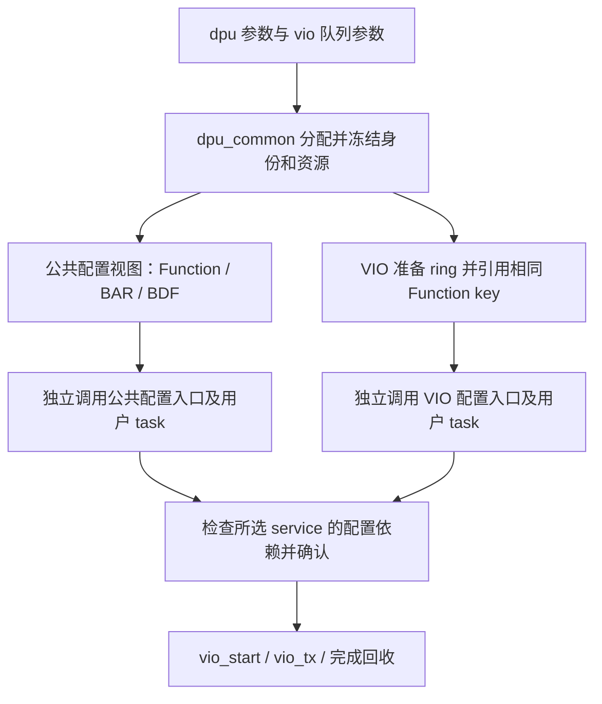

# VIO 外部设备配置接入：Packed 与自定义队列共享分配、配置和运行流程

日期：2026-11-07

状态：用户已批准，正在实现。各接口是否完成以源码和验证记录为准。
实现中用户又提供了当前驱动；新增对照与兼容边界见
[当前驱动核对记录](2026-11-07-current-driver-compatibility-notes.md)。

本次修订纳入后续要求：项目仅使用外部设备配置流程；导出所有身份、BAR、队列、
中断和表项信息；逐类预留用户 task；用户 task 可直接复用 `pcie_work` 访问 DUT。
队列数按队列对计数，32 对表示 32 条 TX 和 32 条 RX。支持显式选择轮询或 MSI-X。
最新接口约定：公共设备配置与 VIO 配置分开；BAR、BDF、MSI-X、QSCH、VIO 队列
分别提供可独立调用的批量入口。每个用户 task 只接收一个完整配置记录，用户实现
单项写法，环境按本次选择范围遍历。同一份冻结 DPU 快照负责各类信息的关联。
表项采用“每张硬件表一个 `struct packed`，外层一个普通 cfg”的形式，支持按域
赋值；硬件位域、资源身份和访问方式分别表达。六张截图的字段及与旧版差异见
[截图核对记录](2026-11-07-dpu-queue-interface-image-notes.md)，其中缺失或冲突的
规格只标为待补齐输入，不用旧版假设补出新地址或编码。
最新平台约束：DUT 不包含真实 PCIe IP，通过 Intel HARD_IP 侧 BFM/bind 驱动
应用接口。项目配置统一使用 Memory Read/Write；不发现 PCI capabilities，不写
标准 PCI 配置空间 BAR/Command/MSI-X capability，也不等待相应配置 Completion。
推荐目标输入改为 `pf0.bar0`、`pf0.vf3.bar0` 等逻辑路径；环境解析实际 BAR
地址，并在分配冻结后打印完整映射。直接传物理 BAR base 只保留为显式调试入口。

## 1. 已确认的需求

用户要求由 `dpu_common` 管理 Host、PF/VF、BDF、BAR 和队列资源分配，
显式指定 VIO 的队列数量、大小和模式，并从这些分配结果获得实际 DUT 配置所需的信息。
VIP 跳过前期与 DUT 的发现、复位、协商及寄存器配置；项目自己的 task/sequence
取得同一份配置后，主动设置 BAR、VTX/VRX、QSCH 等，随后通过 VIO 控制发包。

用户只需为每类配置编写一次通用 task。qid、BAR 基址、ring 地址、模式及中断等
信息封装为该 task 的一个输入配置记录；环境负责为所有需要配置的项生成记录并
逐项调用。用户无需在 test 中手写 Host/PF/VF/队列循环，也无需为每个 qid 写 task。
各类配置能够单独运行：只配置 BDF/BAR 时不依赖 VIO ring 的准备；只配置 VIO
队列时消费已经分配的身份和 BAR，不隐含重写其他表。实际创建的 PF/VF、配置
操作选择的 PF/VF、启用 VIO 的 PF/VF 是三个分别确定的集合。

用户已进一步确认：本次使用 **Packed ring，TX 数据包含标准 `virtio_net_hdr`
和 Ethernet 报文**。沿用现有 SG/descriptor chain 表达 header 与 payload，
不额外要求二者在 Host 内存中物理连续。

用户随后要求同时覆盖现有自定义模式 `VQ_CUSTOM`。两种模式共用本地准备、
外部设备配置、提交确认和发包接口，保留各自的描述符、完成和报文格式。
标准 Packed 的报文头要求不扩展到自定义模式：当前自定义数据路径不带
`virtio_net_hdr`，它通过私有 descriptor 字段传递控制信息。

继续采用一个项目 `env extends uvm_env` 和一个 `env_cfg`，直接组合 DPU、PCIe TL
及各 Host 的 VIO；不新增项目 env 继承层。默认传输仍是已有 Intel PCIe bind，
每 Host 一组接口，同 Host 的 PF/VF 共享接口。参数保持 `dpu.*`、`vio.*`、
`pcie_cfg.*`；`integration/` 仍是独立参考，不进入生产 filelist/package。

成功标准是：准备阶段没有 VIP 发起的设备配置访问；项目读取的配置与实际 ring、
DMA 映射和 notify 完全一致；项目完成配置前不能提交报文；完成配置后能够通过
既有发包命令运行，并分别正确处理 Packed 完成或私有 CQ，回收对应资源。

## 2. 项目仅保留外部设备配置接入

项目 env 固定采用“准备→按类导出→环境按类遍历调用用户 task→确认→发包”，不再提供选择标准
主动初始化的项目参数。删除原项目 `configure_device()`、base_test 对它的调用、
默认寄存器计划 executor 的安装，以及对应自动配置的 Tcl 命令入口。

项目命令面保留 `vio_start/vio_tx/vio_wait_rx/vio_stop` 和用户自己注册的配置 sequence；
不注册 `vio_init/vio_reset/vio_set_mq/vio_set_rss` 来间接恢复原配置流程。
用户需要复位或改变队列时显式执行自己的设备 task，再使用资源生命周期接口。

删除范围是当前项目接入链路的主动配置编排；DPU 的分配/查询/编码、PCIe 读写
以及其他独立标准驱动测试使用的公共实现保持各自职责。项目不会选择旧的自动
配置协议。尤其不能把 PCIe 访问能力一起删掉：它是用户 task 写 DUT 的底层通道。

本地准备不能靠改变 FSM 公共字段或伪造寄存器读写成功完成。DPU env 可以在
`executor=null` 时解析并发布快照；项目只负责绑定给用户使用的 PCIe 访问接口，
不安装自动执行寄存器计划的调用链。



## 3. 配置来源与所有权

| 信息 | 唯一来源 | 项目取得后的用途 |
| --- | --- | --- |
| Host、segment、PF/VF 身份、service key、BDF | DPU device snapshot | Function 路由、BDF 和身份表设置 |
| 各 BAR 的角色、BAR 编号、base、size | DPU device snapshot 的 BAR 租约 | 配置硬件 BAR，确定 MMIO 窗口 |
| virtio pair、本地 RX/TX qid、全局 qpair、local/global MSI-X 映射 | DPU resource snapshot | VTX/VRX 索引、notify/qid 映射及 QSCH 关联 |
| 本次启用的 pair 数、队列深度、队列格式、方向及协议配置 | 已加载并冻结的 VIO service 配置 | 配置有效队列集合与设备数据面行为 |
| Packed 的 desc/event 区，或自定义 desc/CQ 的 GPA/IOVA、长度 | VIO 实际内存分配和映射结果 | 将设备可见 IOVA 写入队列寄存器 |
| notify BAR、最终字节 offset、写宽度与数据编码 | 项目显式提供的通知配置，结合 DPU BAR 租约校验 | VIP 发出准确的通知 |
| MSI-X Table/PBA 布局、Message Address/Data、mask、队列到向量映射 | 平台中断配置与 DPU 分配结果，在本地统一校验/冻结 | 用户配置设备，VIP 绑定相同的中断接收规则 |
| QSCH 的 TC、端口、权重等调度策略 | 项目在准备前提供的 cfg，或显式调用的 DPU 纯策略生成能力 | 用户 task 消费同一份策略配置调度，不由 VIO 队列层决定 |

BAR 地址是设备的 MMIO 地址。ring 的 GPA 属于 Host 内存，IOVA 是设备 DMA 地址；
三者分别导出，项目必须用 IOVA 配置设备 DMA，不能默认 GPA 与 IOVA 数值相等。

若用户需要固定 BAR 地址，应在 DPU snapshot 冻结前通过原有 BAR request 设置
`DPU_ALLOC_PINNED` 和 base。VIO 继续消费解析结果，不再增加独立的 BAR base 参数。

现有 DPU 绑定明确区分 `virtio_pair_index`、`local_pair_id` 和 `global_qpair_id`。
标准 profile 中 pair p 的 RX/TX 本地 qid 为 `2*p`、`2*p+1`；两方向消费同一个
全局 qpair。项目不得用本地 qid 或 `qid >> 1` 替代快照给出的全局编号。

队列 owner 与配置寄存器的访问目标分别记录。VF 队列的 notify 可以位于 VF BAR，
而 VTX/VRX、BDF、MSI-X 映射及 QSCH 全局表可能通过 AF BAR 访问。导出完整 AF
身份和 BAR，并在每个表项中携带实际访问目标，不根据队列 owner 猜测寄存器位置。

### 3.1 独立配置使用同一个关联键

当前 `dpu_function_key_t` 是 `{host_id, pf_id, kind, vf_id}`；`kind` 区分 PF/VF，
VF 的 `pf_id` 同时指定其父 PF。segment 不属于该逻辑键，而是从同一快照查询
得到的 PCIe 域信息。完整关联关系为：

```text
function_key
    ├── PCIe 身份：Host / segment / BDF
    ├── global_function_id
    ├── BAR 租约：role / even_bar_id / base / size
    └── service_key = function_key + service_kind + instance
            └── VIO qpair：local pair / RX-TX qid / global qpair / vector
                    └── 本代实际 ring / DMA 地址
```

现有 `dpu_device_snapshot` 已提供 `list_functions()`、`get_pcie_id()`、
`get_global_function_id()`、`list_bars()`、`get_service_owner()`；资源快照提供
service 到 qpair 的映射。各配置入口都从这些结果派生记录，不各自分配 BDF、BAR
或全局编号，也不以数组下标连接不同列表。BDF 是可配置的 PCIe 地址，不用作
跨快照不变的逻辑主键；同数值 BDF 在不同 Host/segment 中必须保留域隔离。

记录和配置完成状态同时绑定冻结快照身份。VIO ring 有自己的准备代号，重建
ring 不自动重分配 BAR/BDF；改变 DPU 拓扑或设备复位则使受影响的旧配置状态失效。
同一个数字 global ID 在新快照中可能属于另一个 Function，不能沿用旧成功记录。

### 3.2 PF/VF 数量与本次配置范围

公共配置默认使用 `dpu_device_snapshot.list_functions()` 中实际创建的 Function，
不遍历 DUT 最大能力值。输入计数只是构造拓扑的便捷方式，最终循环以冻结列表
为准，因此可表达不同 PF 下不同 VF 数量以及显式选中的非连续 VF ID。

每个批量入口接收一个绑定到快照的 scope，可选择全部 Function、某 Host、某 PF
及其 VF、一个准确 Function，或一组明确的 Function key；BAR 入口还可筛选角色。
筛选只决定本次写哪些项，不重新编号或重新分配地址。scope 中未知 key 必须报错。
选择一个 VF 不会隐含配置其全部兄弟 VF；缺少父 PF/AF 或访问路径的前置配置时，
返回缺失依赖，交给调用方显式配置，不扩大范围写其他表。

例如创建 Host0/PF0/VF0、VF1，则有 PF0 加两个 VF 共三个 Function。若各自有
BAR0/1、BAR2/3、BAR4/5 三个 64 位窗口，全部范围共有九条逻辑 BAR 租约，选
VF1 时只处理它的三条租约。64 位 BAR 的高低 DWORD 属于同一条租约。
只有 VF1 启用 VIO 时，仍由公共配置 scope 决定是否配置 PF0/VF0 的 BAR/BDF；
`vio.enabled` 仅选择业务，不负责删除公共设备映射。

### 3.3 BAR 地址分配与 DUT 映射表分开

本项目没有真实 PCIe IP，BAR 包括两项实际职责：DPU resolver 产生设备地址窗口
租约；DUT 若有自己的地址译码/分配表，由用户通过 MMIO 编程。Intel BFM 依据
同一租约产生用户接口的 BAR/PF/VF sideband，不要求先写 PCI 配置空间。
现有库中 bootstrap 的标准 PCI BAR 写入不用于此项目。

保留独立 `configure_bar_table()`，把逻辑 owner、BDF、global function ID、
BAR 编号/base/size 交给用户的映射表 task；取消项目设计中的
`configure_pcie_functions()`、`configure_pcie_bars()` 配置空间入口。
实际表索引、访问窗口和字段编码由平台布局声明/用户方法提供，不假定额外
BAR 表的地址或索引等于 global function ID。BDF 表本身同样是 DUT 的 MMIO 表，
不是 PCI 配置空间。分配并冻结这些值不会自动写入 DUT。

若硬件按 Function/BAR 一条表项，环境逐租约调用；若按父 PF 下的一组 VF 窗口
编码，则根据平台声明的粒度生成一个包含完整成员租约列表的 cfg，再调用一次
对应方法。不能只传 VF 个数后假定其地址连续；聚合格式有连续性、stride 或
VF ID 约束时必须检查实际租约，无法表示则报错。无需为这种用户 DUT 映射
伪造标准 SR-IOV capability 或 VF Type-0 配置空间。

首次访问所用的管理窗口必须由平台固定译码/已知入口或用户就绪流程保证可达。
不能要求先写一个表才能访问它自己；DPU 租约只说明预期地址，不能证明 RTL
已经接受该地址。初始入口与正常运行后的映射关系由平台声明并验证。

### 3.4 平台布局和硬件编号必须显式绑定

截图不是当前旧编码器的完整兼容版本：VTX bit72 是 `high_speed_mode`，VTX/VRX
的中断字段为 13 位，VRX 为 128 位并增加预取字段；QSCH 的 net/group 为 10 位，
N2G/G2P 偏移分别为 0x12000/0x14000。旧 G2P/TC weight 地址不能混用到新布局。
项目参考选择明确的布局版本，并记录每个表的模块实例、管理窗口、表内偏移、
深度、索引映射及访问方法。截图给出的 0x10000 等只表示图示表地址，模块基址
仍由平台提供；不同截图的重复地址不意味着同一张表。

Function key、PCI BDF、global function ID、vport ID、Pfvf ID、QSCH net/group ID
各有自己的含义。平台在准备前提供映射，环境验证与真实分配的一致性：

- requester BDF 表的 16 位 ID 按 DUT Host 的 EP/SW 模式编码；Intel `sv_if_mode`
  仅选择 PCIe VIP 接口，不替代该模式。completion BDF 表独立配置。
- PFVF 的 `First_vf_offset` 与实际 VF routing ID 对应；MSI-X linear 消费其
  `Pfvf_id`，不能凭 VF 数量或旧 source ID 推算。
- VTX 的 sport_id 按图为 vport ID；VRX dport_id、MSI-X info 的 Function 字段
  分别按平台规则绑定，不默认等于 DPU global function ID。
- QSCH 的 qid 表索引、net、group、端口分别绑定。N2G/G2P 按共享项去重，
  dpt 的 Host 编码取决于实际 ETH 数量，lvl2_id 取决于 VNET/ETS 模式。

缺少必需映射时，相关表的导出/配置返回明确错误，不影响不依赖该表的独立入口。
PBA 总位数、notify 低 7 位局部编码的图文冲突、Packed/Split 的额外选择机制、
VTX/VRX 完整间接写端口和额外 BAR 硬件表布局，需由对应 RTL/完整规格或项目
显式布局声明补齐。不能把这些截图尚未给出的部分标成已经可运行。

## 4. 本地准备与导出的配置对象

公共信息使用拟新增项目参考类型 `project_dpu_setup`，从已有冻结 DPU 快照生成
Function/BAR/BDF 和公共表项记录，不拥有资源，不访问 DUT，也不依赖 VIO ring。
该类型和公共 scope/值记录放在 `integration/project/project_dut_config.sv`，
只被参考 package 显式引用，不进入生产 VIO 包；不新增 env 或分配器。
公共表 packed 类型与外层 cfg 也放在此文件。VTX/VRX/notify 的平台位域和结合
VIO ring 记录的外层 cfg 放在拟新增 `integration/project/project_vio_config.sv`；
通用 `vio_queue_setup_t` 只表达逻辑队列，不依赖这些项目硬件布局。两个参考文件
均由参考 package 显式引用，不进入原生产 filelist/package。

`vio_external_setup` 仅汇总本次选择的 VIO service，引用同一快照及相关公共租约，
不包含公共设备表的批量写入计划。每个 service 包含：

- 完整身份、BAR 租约和所引用的冻结快照身份。
- 请求及实际启用的队列对数、方向、队列格式、深度、feature 或私有控制配置。
- 每对队列的本地/全局映射，以及每条实际准备队列的 ring GPA/IOVA、长度。
- 各模式的初始索引和 wrap 状态、明确的通知地址与编码。
- Packed 明确导出 driver/device event 地址；自定义明确导出 CQ 地址、格式、
  有效长度和可用 descriptor 数，不能让项目把 CQ 误解为 Packed event 区。
- 轮询或 MSI-X 完成模式、所消费的向量映射与消息配置；公共 MSI-X 表由独立入口配置。
- 本次准备代号、已准备/已确认状态；外部只通过查询方法取得值副本。

视图不拥有 ring。ring、payload、DMA 映射仍由 VIO ops/queue manager 管理，
项目不释放这些内存。修改返回的副本不得改变实际队列或已冻结视图。

准备阶段必须完成所有本地检查和分配，不执行 PCIe Config Read/Write、
设备 MMIO Read/Write 或 notify。初始化 ring 时写 Host 模型内存是允许的。
队列深度必须明确且非零；外部模式不能沿用 `queue_size=0` 的“读取设备上限”语义。

准备接口拆分现有 `setup_queue` 中的本地资源准备与设备编程：

1. 检查 service/Host/BAR/队列资源和能力声明。
2. 按模式创建队列，分配并映射 ring，按对应协议初始化内容、索引和 wrap。
3. 保存实际 queue program 与资源所有权，导出配置视图。
4. 等待项目显式完成设备配置，之前禁止 dataplane 提交和通知。

标准模式的原 `setup_queue` 继续组合本地准备、标准设备配置和激活，保持原行为。
不通过给标准后端添加“假成功”的 MMIO 接口实现外部模式。

### 4.1 Packed 与自定义模式的格式差异

| 项目 | 标准 Packed：`VQ_PACKED` | 现有自定义：`VQ_CUSTOM` |
| --- | --- | --- |
| TX 数据 | `virtio_net_hdr` 和 Ethernet payload | Ethernet payload，不带 `virtio_net_hdr` |
| 描述符 | 标准 Packed descriptor，16 字节 | DPU 私有 W1/W2 descriptor，16 字节；字段语义不同 |
| 完成 | Packed descriptor 的 USED/wrap | 私有 CQ |
| Host ring | descriptor 区和两份 4 字节 event 区 | 连续 desc + CQ，整块按 4096 字节对齐分配 |
| TX CQ | 无独立 CQ | desc 后的 2 字节 head/wrap |
| RX CQ | 无独立 CQ | desc 后的 N 个 16 字节 CQ 项 |
| 可用容量 | 按现有 Packed 分配规则 | N 个 descriptor 槽保留一个，最多 N-1 个在途 descriptor |
| 深度约束 | 现有 Packed 几何检查及项目声明能力 | 2..4096 范围内的 2 次幂 |
| 控制信息 | 标准 header 与声明的 features | `dport_info/dport_id/dport_type/cpu_tx_cos/fwd/rss_lag/l3_cs/l4_cs` 等私有字段 |
| 通知 | 显式选择标准 16/32 位编码 | DPU 固定 32 位 `{wrap[31], tail[30:16], local_qid[15:0]}` |

自定义 TX 的有效 ring 字节数为 `16*N + 2`，RX 为 `32*N`，分配长度向上取整到
4096 字节边界。CQ 的设备可见地址由整块 ring 的实际 IOVA 与偏移计算并导出，
不能单独按另一个地址规则分配。现有自定义 TX CQ 初值为 `16'h8000`；RX CQ 清零，
索引为零且初始 wrap 为一。准备过程复用这些协议初始化规则，不能统一清零后
直接开放发包。

项目固定由用户配置设备；`queue_type` 选择数据格式，与配置所有权无关。
新外部协议必须按 service 安装相符的 queue 和配置后端，允许不同 service 使用
不同格式；同一个 service 内本次保持单一格式，冻结后不能原地切换。

目前的 `virtio_function_instance` 是根据是否存在 `private_cfg` 选择私有协议，
所以仅设置 `vio.queue_type=VQ_CUSTOM` 不会自动获得完整的私有协议。
外部模式应根据最终队列类型创建/校验匹配的私有配置并绑定，复用
`dpu_priv_driver_config` 的参数和 descriptor 控制逻辑，但不复用其设备初始化。

现有 `dpu_priv_config_backend` 在 discover、configure_queue、enable_queue、reset
中访问 DUT；其配置面仅实现 AF 路径，并以 `local_qid >> 1` 推导部分全局队列/向量。
外部模式不调用这些步骤。全局 qpair 和 MSI-X 映射全部来自 DPU snapshot，
项目负责按真实 Host/PF/VF 配置设备，因此不能把原 AF 模型测试当作新模式的
多 Host/PF/VF 支持证明。

自定义本地 qid 仍需满足现有 u8、方向和唯一性约束，并与 snapshot 一致。
旧 `local_qid_base`/单队列覆盖若与冻结绑定冲突，应在准备前报错；不在另一层
重新分配身份。通知编码使用本地 qid，全局 qpair 单独交给项目配置硬件映射。

### 4.2 可逐项查询的数据记录

公共视图提供 Function/BAR/BDF 及公共表项查询；VIO 视图提供 `list_qpairs()`、
`list_tx_queues()`、`list_rx_queues()`、notify 项和按完整 service/queue key 查询。
下面汇总两个视图的记录，不要求把公共记录类型定义在 VIO 内部。
每条队列记录包含 owner key；外部即使只遍历扁平队列列表，也能找到唯一 Function。
返回值副本，不能通过修改视图把已分配队列改挂到另一个 PF/VF。

| 记录 | 必须导出的字段 |
| --- | --- |
| Function | Host、segment、PF/VF kind、PF ID、VF ID、所属 service key 集合、BDF、global function ID、source ID、RC slot |
| BAR | Function key、角色、实际 BAR 编号、64 位 base/size、对应 Intel sideband 和 DUT 映射表引用 |
| Qpair | service key、virtio pair index、placement local pair、global qpair、RX/TX local qid、local/global MSI-X vector |
| 每条 TX/RX 队列 | Function owner、service key、方向、格式、深度、实际可用槽数、desc/event/CQ 的 GPA/IOVA/长度、初始索引/wrap、RX buffer 大小、notify 信息、向量引用 |
| 表项访问位置 | 目标 Function/Host/segment/BDF、BAR 编号和基址、字节 offset、绝对 MMIO 地址、访问宽度、表索引、布局是否已提供、本次是否必需、表项 valid 值 |
| 中断项 | Message Address、Message Data、table slot、全局/本地 vector、消费该 vector 的队列集合、mask、启用状态 |

每条 queue 是一份配置记录，但它会引用共享的 Function/BAR/qpair/vector 记录。
共享表项去重后单独列出：一个 BDF 项只按 Function 配置一次，一个 MSI-X 项只按
实际向量配置一次。对 32 对队列不能盲目重复配置 64 份相同 BAR/BDF/MSI-X 项。

交给用户 task 的记录同时包含它需要的共享信息值副本。例如，VTX 的单个 cfg
包含队列 owner、实际管理寄存器访问目标、qid、BAR 基址和 ring 地址，用户无需
再传一个 AF 对象或在 task 中按 qid 查找全局 env_cfg。附带共享字段是为了单项
配置方便；环境仍按每类表自己的集合调度，不在每个 VTX task 中重复配置 BDF/BAR。

公共 Function 列表覆盖 DPU 已创建的身份，并标出 AF 和实际承载 VIO 的 service。
表项没有布局与表项需要写入 `valid=0` 是两件事：前者不能发起访问，后者仍可能
是停用某条映射的必需写操作。只有平台声明存在 shadow bank 时才包含其清理
语义；截图版 notify 未提供这种机制。记录必须明确区分，不能用一个 valid 位混用。

BAR 基址既可由 DPU 分配，也可在解析前明确指定。按当前参数格式，固定 VF0
BAR0 的输入为 `dpu.h0.pf0.vf0.bar0.placement=DPU_ALLOC_PINNED` 和
`dpu.h0.pf0.vf0.bar0.base=<基址>`；BDF 用同路径下 `bdf_mode/bdf` 指定。
实际地址必须满足对应 DUT BAR profile 的大小和对齐，导出时保留真实解析结果。

### 4.3 32 对队列的归属与显式指定

一个 VIO service 的所有队列属于它的一个 PF 或一个 VF。32 对集中在一个 service
时，对号为 0..31，RX local qid 为 0,2,...,62，TX 为 1,3,...,63；global qpair
编号仍取实际分配结果，不保证等于对号。该 Function 的 BAR 由所有这些队列共享。

`vio.pairs=32` 是所有选中 service 的缺省值，不表示将全项目总共 32 对自动均分。
若要 VF0 16 对、VF1 16 对，应分别指定两个 service 的需求；若要仅一个 VF 有
32 对，应明确选择该 VF，不让其他已创建 Function 也获得默认业务队列。

拟增加 `vio.enabled` 的全局/Host/service 覆盖，项目在 DPU placement 冻结前读取：
`vio.enabled=0` 加 `vio.h0.pf0.vf0.i0.enabled=1` 表示只为 VF0 的 i0 创建本次业务。
它只选择 VIO service，不删除 PF/VF 身份对象。每个启用 service 独立创建固定目标
placement request，按最终 `pairs` 精确申请；取消原先一个 request 按最大默认
pairs 给所有候选统一预留的做法。既有 DPU request 覆盖不自动与新生成器混用，
显式自定义 authoring 与数量生成器只能选择一种入口，以免两套需求相互覆盖。

以下是更新后参考环境的目标参数示例，其中 `enabled` 属于拟新增参数：

```text
+dpu.hosts=1
+dpu.pfs_per_host=1
+dpu.vfs_per_pf=1
+vio.enabled=0
+vio.h0.pf0.vf0.i0.enabled=1
+vio.h0.pf0.vf0.i0.pairs=32
+vio.h0.pf0.vf0.i0.queue_type=VQ_PACKED
+vio.h0.pf0.vf0.i0.queue_size=512
```

若需要固定该 VF 的 BDF/BAR，使用已有输入，示例地址位于参考 Host0 的 MMIO
窗口内；其他固定 BAR 仍需由 resolver 校验互不重叠：

```text
+dpu.h0.pf0.vf0.bdf_mode=DPU_ALLOC_PINNED
+dpu.h0.pf0.vf0.bdf=0x0011
+dpu.h0.pf0.vf0.bar0.placement=DPU_ALLOC_PINNED
+dpu.h0.pf0.vf0.bar0.base=0x0000002080000000
+dpu.h0.pf0.vf0.bar4.placement=DPU_ALLOC_PINNED
+dpu.h0.pf0.vf0.bar4.base=0x0000002081000000
```

该例中 AF 位于 PF0，32 对业务队列属于 VF0。当前 DPU 每 Function 上限为 32 对，
而 AF 的 11 对额外队列也计入同一上限，因此默认 AF 最多容纳 21 对普通 VIO 队列。
不能在默认 AF 上直接申请 32 对普通队列。选择普通 VF 或非 AF PF 才能在现有
能力范围内集中申请 32 对；总量仍受全局 qpair、所选 notify 表布局和 MSI-X 容量限制。
不得为了让例子通过而静默修改真实能力或取消 AF 额外资源。

AF 额外队列/中断资源在导出对象中单独分类，供用户配置相关表，不伪装成 VF0
service 的 32 对业务队列，也不在没有数据面配置时给它们虚构 ring 地址。

### 4.4 轮询、MSI-X 地址与运行方式

沿用 `vio.completion_mode=VIRTIO_COMPLETION_POLLING` 或
`VIRTIO_COMPLETION_MSIX`，补齐精确 service 级覆盖。项目默认轮询，显式选择后
冻结；不做自适应切换，不自动修改 DUT 中断 mask，不降级为 INTx。

- 轮询：按配置间隔检查 Host 的 Packed USED 或私有 CQ，不要求 DUT 发中断。
  仍导出 DPU 分配的向量与映射信息，设备是否要求配置某些内部中断字段由用户
  task 决定；VIP 不据此宣称 DUT 已开启中断。
- MSI-X：本地导入已声明的向量、Message Address/Data 和队列映射，用户配置
  设备表项与使能，确认后通过 Intel/PCIe monitor 捕获实际 MSI-X Memory Write
  唤醒对应队列完成处理。超时报告缺失中断，不能靠轮询兜底让中断测试通过。
- 共享向量：允许一对 RX/TX 或多个 pair 引用同一向量，接收后处理其全部队列。
  不假定 64 条 RX/TX 队列就需要 64 个向量，也不私自占用 vector 0 做 config 中断。

MSI-X 必须区分三种地址：

1. **Table 地址**：设备 BAR base + table offset + 实际 table slot * 16。
   slot 取 DUT 全局/局部表的实际映射，不默认等于 Function local vector；
   导出 address low/high、data、mask 所在位置。
2. **PBA 地址**：设备 BAR base + PBA offset，以及对应 pending bit/长度。
   PBA 是 pending 状态信息，不能把它当成普通初始化表让用户循环写零。
3. **Message Address**：DUT 发往 Host 的中断目的地址，独立于设备 BAR 和 ring IOVA。
   Message Data 也显式导出，不能用它的低位重新猜测 local/global vector。

平台提供 DUT 消息表/PBA 的 BAR、offset、table size，以及实际需要的 MMIO
中断控制位置；没有 Function 级控制寄存器的平台明确声明仅采用表项控制。
本项目不执行 MSI-X capability 发现或配置；准备阶段只做边界/身份校验。
Message Address/Data 可以由平台逐向量设置，也可用显式 base/stride 模板生成，
生成结果与 Host 中断接收匹配表使用同一份冻结值。

公共中断输入在项目 `env_cfg` 注册为 `dpu.msix.table_bar/table_offset/table_size/`
`pba_bar/pba_offset`、`dpu.msix.msg_addr_base/msg_addr_stride/`
`msg_data_base/msg_data_stride` 和逐向量覆盖；支持 Host/Function 级覆盖，不要求
存在 VIO service。VIO 仅保留 `vio.completion_mode` 并引用公共中断记录。
平台已经有中断配置对象时可以通过 cfg 直接注入。MSI-X 模式下缺布局或
地址/数据时失败，轮询模式下可将消息表/PBA 布局标为未提供。

`table_size` 表示实际表项数；逐向量覆盖路径为 `dpu.msix.vN.msg_addr/msg_data/masked`，
N 是该 Function 的 local vector，不等于全局硬件表的 slot；精确路径为
`dpu.hH.pfP[.vfV].msix.vN.msg_addr/msg_data/masked`，无 service instance 层。
模板按 `base + local_vector * stride` 计算，逐向量值优先；检查地址/数据位宽、
Table/PBA 对齐与范围、占用槽位和布局重叠。同一 Function 内多个 service 的
共享布局和向量设置必须一致，不能因不同 service 引用而把同一表项导出两种值。

同 Host/segment 的不同 Function 不能使用有歧义的接收匹配项。不同 Host 的相同
BDF 或 Message Address/Data 必须由实际 RC/Host 域隔离。观察器按已配置项匹配
并返回该项的向量身份，不限制成固定 APIC 地址，也不通过 Requester ID 或 data
低位猜测未知消息。此规则仅用于新外部协议，不改变其他独立传统场景的含义。

准备阶段建立本代本地接收规则，先于用户使能设备中断；消息使用可保留的计数或
待处理状态，避免早到消息因 worker 尚未等待而丢失。READY 前不提交报文或回收
队列。共享向量的 service 必须使用相容的完成模式；轮询不能替其他 service
消费中断状态。DPU 的 self-mask 字段照常导出；若用户启用自动屏蔽，重新使能由
用户运行期 task/sequence 明确执行，VIP 不隐式写回，连续中断验证必须覆盖此流程。

DPU AF 管理窗口中的全局 MSI-X 表与 Function 窗口中的消息表按实际 DUT 布局
导出；不强制制造一个不存在的标准 PCI MSI-X Table 别名。若多个窗口映射到
同一存储，平台显式声明对应关系，由环境选择写入视图，避免重复写入冲突值。

目前私有配置路径强制 polling，标准 TX worker 也包含周期轮询，通知管理器会
在配置和 mask/unmask 中写设备。因此 MSI-X 接入是本次必须实现并验证的完整
路径，不能只注册一个枚举参数或复用 `setup_msix()` 的设备写操作。

### 4.5 按表定义 packed entry，按项传递普通 cfg

采用两层值类型，不把全部表合成一个大结构体，也不为每张表引入新的 UVM 配置类：

1. `project_*_entry_t` 为 `typedef struct packed`，成员按硬件高位到低位声明，
   包含精确保留位，`$bits()` 等于该表的 32/64/128 位宽。这样可写
   `entry.dma_msix_en = 1'b1`，无需用户手算位移。
2. `project_*_cfg_t` 为普通非 packed struct，组合上下文、关联记录和一个 entry。
   上下文含快照/配置代号、布局版本、表索引以及实际访问目标；队列 cfg 再含通用
   `vio_queue_setup_t binding`。共享表 cfg 携带其真实 owner/消费者集合，不伪装成
   一条队列。用户 task 的唯一配置输入就是该 cfg。

现有 `dpu_function_key_t`、BAR lease 本身含普通结构体，不应强塞进 packed entry。
cfg 是值记录，不拥有 ring、快照或 PCIe sequencer。需要随机约束或 `load_params()`
时继续在原 env_cfg/所属配置类中处理，解析后的值填入 entry；struct 自身不注册参数。

按图中 ASIC VRX 定义的结构体示意如下。FPGA 使用同一 128 位线格式时，应强制
`dsc_pre_read_ram_addr[14]` 为零，并使用 FPGA 的表深度和 RAM 容量限制。
以下均为设计示例，尚未加入源码。

```systemverilog
// 项目 VRX queue_para_table 的 128 位镜像。
// 使用 logic 保留 X/Z，发送前检查；保留位初始化为零，不能写回读取的 RO 状态。
typedef struct packed {
    logic		reserved_127;             // [127]
    logic [14:0]	dsc_pre_read_ram_addr;     // [126:112]，单位为 descriptor 槽
    logic [2:0]	dsc_pre_max_num;           // [111:109]，0 表示 256 槽
    logic		reserved_108;             // [108]
    logic [1:0]	dsc_pre_read_threshold;    // [107:106]
    logic [1:0]	dsc_dma_num;               // [105:104]
    logic [1:0]	dsc_mode;                  // [103:102]
    logic [2:0]	payload_dsc_len;           // [101:99]
    logic [1:0]	head_dsc_len;              // [98:97]
    logic		dma_msix_en;               // [96]
    logic [12:0]	dma_msix;                 // [95:83]
    logic [9:0]	dport_id;                 // [82:73]
    logic [2:0]	dport;                    // [72:70]
    logic		virtio_mode;              // [69]
    logic		queue_en;                 // [68]
    logic [3:0]	q_depth;                  // [67:64]，log2(descriptor 数)
    logic [63:0]	dsc_addr;                 // [63:0]，设备可见 ring IOVA
} project_vrx_entry_t;

// 上下文保存“本代哪张表的哪一项、通过哪个 Function/BAR/模块访问”。
// target 还描述直接/间接方式及已声明的端口，不能把读地址当成间接写地址。
typedef struct {
    longint unsigned		snapshot_id;
    longint unsigned		config_generation;
    string			layout_id;
    project_table_target_t	target;
    int unsigned		table_index;
} project_table_context_t;

// binding 保存真实 owner、qid、ring、完成方式；entry 保存对应的硬件编码。
// 两者在构造时做一致性检查，后续用户写 task 只消费这个完整参数。
typedef struct {
    project_table_context_t	ctx;
    vio_queue_setup_t		binding;
    project_vrx_entry_t		entry;
} project_vrx_cfg_t;
```

队列深度为 512 时，填 `entry.q_depth = 4'd9`，不填 512；`entry.dsc_addr`
取 `binding.desc_iova`，`entry.dma_msix_en` 按完成方式产生。平台 dport/dport_id
由已校验的 Host/Function 映射产生；MSI-X 字段来自实际映射，不截断 global ID。
初始 `queue_en=0`，由独立使能 task 在依赖完成后改变。VTX 没有截图未定义的
`dma_msix_en` 位，不能为了两方向类型相同而虚构它的布局。

按域赋值分两类：用户在准备前给策略字段赋值，例如预取容量、水线、DMA 一次
读取数量、QSCH COS 等；环境根据冻结资源填 owner/qid/BAR/向量/ring，并生成
完整 entry。可给每项提供不同策略，环境统一遍历并应用。已导出的值副本不能
通过改 `dsc_addr/q_depth/dma_msix/virtio_mode` 改变实际绑定；需要修改时，更新
所属配置并按生命周期重新校验/生成受影响配置代号。独立使能阶段按合同改变
queue_en/mask 属于已声明的操作，不允许任意重写其他冻结字段。

字段检查必须在把宽整数赋给窄位域之前执行，否则截断后已经无法发现原输入
越界。打包后还检查 `$isunknown(entry)`、保留位和 `$bits(entry)`，通过后才能
转换成 PCIe 使用的二态数据。struct 的高低位排列只定义数据镜像，不决定 PCIe
字节顺序、DWORD 写入顺序或间接端口协议；这些仍由单项用户 task 按布局执行。
可用范围还受实际表深度和关联映射限制；例如 13 位中断字段不代表其引用的
MSI-X info/message/PBA 都有 8192 项，必须逐个检查真实目标容量。

需要的 typed entry 清单及完整已知位域示例见截图核对记录第 7 节：

| 分组 | 每表一个 entry 的范围 | 外层配置的关联信息 |
| --- | --- | --- |
| VIO | VTX、VRX、VIO notify | service/queue binding、表索引、管理目标 |
| 公共身份 | requester BDF、completion BDF、PFVF map、TLP prefix | Function/BDF/实际平台 ID、访问目标 |
| 公共中断 | MSI-X linear、info、interval、message table | Function、local/global vector、消费者、目标 |
| QSCH | Q2TC、N2G、G2P | queue/net/group/port 绑定及共享消费者 |
| 可选 RDMA 公共表 | RDMA notify、RNET | 显式提供的 RDMA 资源引用；VIO 不自动产生 |
| 状态 | PBA word、MSI-X stat、PFVF drop status/clear mask | 独立 read/check/clear，不能进入普通初始化写循环 |
| BAR 地址分配 | 先复用 `dpu_bar_pair_lease_t` 的逻辑记录 | 待硬件表位定义提供后再增加 packed entry，不编造布局 |

VRX 预取地址是另一种本地 RAM 资源，不等于 ring IOVA。项目准备层按实际共享
RAM 实例统一安排和保存区间；配置 scope 只引用已有区间，不每次从零重新分配。
起始索引按解码后容量对齐、区间不重叠且不越 ASIC 32K/FPGA 16K 槽，预取容量
严格小于 ring 深度。配置深度还取硬件与 VIP 模式能力的交集：图中范围为
2^5..2^15，VTX 高速模式至少 2^7；现有 Custom 上限为 4096，不能因为位域能表示
32768 就宣称 VIP 支持。当前 Custom 的 `dsc_mode=1` head_split 明确拒绝。

## 5. 项目 env / test 的拟用法

项目仍然只有一个 env 和一个 env_cfg，各类配置作为 env 内独立方法提供。
先通过 `export_dpu_configuration(dpu_setup, ok, why)` 获取公共视图；仅配置 BAR/
BDF 时到此即可。需要 VIO 时再调用 `prepare_vio_resources(vio_setup, ok, why)`
分配 ring，两个视图必须引用相同冻结 DPU 快照。

公共 `project_dpu_config_scope` 从公共视图选取 Function/BAR 集合，VIO 的
`vio_config_scope` 从 VIO 视图选取 service/队列集合。scope 只选择已有记录，
始终携带来源视图和代号，不包含另一份可修改的 BDF/BAR 分配。

以下展示三种独立调用，假定 scope 已从视图构造、所需访问路径已准备。这是
拟新增接口示意，不是包含全部初始化步骤的可运行 test：

```systemverilog
// 只配置本次选中 Function/BAR 的平台地址映射表。
// 环境遍历对应记录，调用 user_configure_bar_mapping_entry(cfg, ...) 。
env.configure_bar_table(bar_scope, ok, why);
if (!ok) begin
    `uvm_fatal("BAR_CONFIG", why)
end

// 只配置本次选中的 BDF 表项，不隐含调用 BAR 或 VIO 配置。
env.configure_bdf_table(function_scope, ok, why);
if (!ok) begin
    `uvm_fatal("BDF_CONFIG", why)
end

// 只配置已准备的 VIO 队列内容，使用已有身份和 BAR 引用。
env.configure_vio_queues(vio_scope, ok, why);
if (!ok) begin
    `uvm_fatal("VIO_QUEUE_CONFIG", why)
end
```

BAR 映射表、AF、MSI-X、QSCH、notify、队列使能和配置验证各有独立入口，见下表。
用户 test/sequence 控制需要调用的类别和先后；环境负责各类别内部的完整遍历。
不要求经过一个包办所有表的 VIO 总入口，不新增强制 `configure_all()`。

需要发包时，项目 env 的 `commit_vio_configuration(vio_setup, ok, why)` 检查
所选 VIO service 自身配置和引用的公共依赖，再向 VIO 核心提交确认；后者不依赖
项目公共表类型。成功后运行 `vio_start/vio_tx`。sequence 可分别注册 BAR/BDF/
VIO 配置命令，复用相同入口，不重新实现循环。

原 `env.configure_device()` 从项目参考中删除，用户迁移后不再调用它。
DPU 的分配、冻结快照及纯表项生成/寄存器编码能力继续供项目显式使用。

### 5.1 用户配置 task 清单

以下均为拟在 `project_env.sv` 中提供的 `extern virtual task`。实现置于同文件
类外，保持中文职责注释和宽松排版。每个 task 仅有一个用于配置的输入参数 cfg，
其类型按 Function、队列或表项区分，里面包含该项所需的全部身份、地址与逻辑值。
`output bit ok, output string why` 仅用于返回结果，不属于额外配置输入。
读取类 task 另外输出对应的 typed 状态记录；不会把读取结果混入配置输入。
未实现的必需 hook 默认返回失败，不把空 task 当作硬件配置成功。

下表各批量入口的遍历由环境提供；build/connect 不会调用它们，运行阶段由 test
或已注册的配置 sequence 显式调用。用户填写每类方法的单项写法即可。
环境只调用本次 scope 内适用的 hook：未启用方向不配置
其运行队列；轮询且未提供消息表布局时不调用对应 Table hook，PBA 独立查询。
必需性在导出时明确检查，不能以
空列表或未实现 hook 返回成功掩盖缺失配置。一个必需 hook 失败立即停止后续使能
和提交，保留资源供用户停止设备后清理。

| 批量入口或独立操作 | 用户 task | 单个 cfg 的配置粒度与信息 |
| --- | --- | --- |
| 平台准备 | `user_prepare_device` | 公共视图中的目标设备：平台复位和配置前条件 |
| `configure_bar_table` | `user_configure_bar_mapping_entry` | 一个平台 BAR 映射单元：相关 Function、BDF/global ID、BAR 租约及实际表目标 |
| `configure_af` | `user_configure_af` | AF/Host：AF 身份、管理 BAR、AF 声明和 Host 选择信息 |
| `configure_pf_vf_map` | `user_configure_pf_vf_entry` | 每选中 PF：First_vf_offset、实际 PF/VF Routing ID 关联和 Valid |
| `configure_bdf_table` | `user_configure_bdf_entry` | requester 表：Function、EP/SW 模式、实际 requester_id、valid/ecrc/vdpa |
| `configure_completion_bdf_table` | `user_configure_completion_bdf_entry` | completion 表：Function、completion BDF、valid/ecrc、独立表目标 |
| `configure_tlp_prefix` | `user_configure_tlp_prefix_entry` | 每选中 prefix 项：TLP prefix、valid/vdpa 和关联 Function |
| `configure_msix` | `user_configure_msix_linear_entry` | 每唯一映射：Host/Pfvf/local vector → global vector、表索引；截图版无 valid 位 |
| `configure_msix` | `user_configure_msix_info_entry` | 每 global vector：Host、Function、valid/self-mask、表地址 |
| `configure_msix` | `user_configure_msix_interval_entry` | 每 global vector：中断间隔/包数策略、表地址 |
| `configure_msix` | `user_configure_msix_control_entry` | 仅平台另行声明时使用的全局控制项；六张图未提供其完整布局 |
| `configure_msix` | `user_configure_msix_table_entry` | 每 DUT 消息表 slot：Message Address/Data、mask、BAR/offset |
| `enable_msix` | `user_configure_msix_function` | 每适用 Function：平台声明的 MMIO 中断使能/屏蔽；没有独立控制寄存器时按声明使用表项控制 |
| 可选状态检查 | `user_check_msix_pba` | PBA BAR/offset、向量对应 pending bit；不是普通写表 hook |
| `configure_vio_notify` | `user_configure_notify_entry` | 每 table slot：局部编码、Host、notify base、global qid、type；截图版无 valid 位 |
| `configure_vio_notify` | `user_commit_notify_bank` | 仅显式声明双 bank 布局时使用；截图版不调用 |
| `configure_qsch` | `user_initialize_qsch` | 仅明确声明的 QSCH 全局初始化；范围覆盖全部受影响消费者时才允许 |
| `configure_qsch` | `user_configure_qsch_q2tc` | 每队列映射项：global qpair、TC、net 等逻辑值及表索引 |
| `configure_qsch` | `user_configure_qsch_n2g` | 每唯一 N2G 项及目标地址 |
| `configure_qsch` | `user_configure_qsch_g2p` | 每唯一 G2P 项及目标地址 |
| `configure_qsch` | `user_configure_qsch_spwrr` | 仅平台提供对应布局时，每唯一 SP/WRR 项；不套用旧地址 |
| `configure_qsch` | `user_configure_qsch_tc_weight` | 仅平台提供对应布局时，每唯一 TC weight 项；不套用旧地址 |
| `configure_vio_queues` | `user_configure_vtx_queue` | 每启用 TX：owner、global qpair、格式/深度、desc/event/CQ IOVA、向量等 |
| `configure_vio_queues` | `user_configure_vrx_queue` | 每启用 RX：同上，并包含 RX buffer 大小、目的 Function/Host 信息 |
| `configure_vio_queues` | `user_configure_queue_aux` | 每 qpair：平台额外 context/tail/list-table 等配置所需身份和 ring 信息 |
| `enable_vio_queues` | `user_enable_queue` | 每启用 TX/RX：依赖项就绪后执行设备使能 |
| 可选 `configure_rdma_notify` | `user_configure_rdma_notify_entry` | 独立 RDMA notify 项；仅显式给出该类资源并调用时使用 |
| 可选 `configure_qsch_rnet` | `user_configure_qsch_rnet_entry` | 独立 RDMA net 的 Host/en；不因配置 VIO 自动写入 |
| 可选状态读取 | `user_read_msix_stat`、`user_read_pfvf_drop_status` | 指定表项的只读结果，输出独立状态记录 |
| 显式状态清除 | `user_clear_pfvf_drop_status` | 单项 W1C clear mask；不把读出的 status 作为普通初始化值写回 |
| `verify_dpu_configuration` | `user_verify_dpu_configuration` | 所选公共表范围的读回、状态等待和成功判定 |
| `verify_vio_configuration` | `user_verify_vio_configuration` | 所选 VIO 范围的读回、状态等待和成功判定 |
| 平台停止 DMA | `user_quiesce_device` | 明确目标 Function/设备范围，为释放/重配提供真实结果 |
| 平台复位 | `user_reset_device` | 明确目标 Function/设备范围；不在错误恢复中自动触发 |

表清单对照六张截图及当前 bootstrap/VIO register plan、dataplane extension 和
私有后端；不同版本只使用自身明确提供的项，不混装为一个“最大能力”布局。
原先未完整自动实现的 context/tail/list-table 也预留 hook，但未知寄存器地址和
平台语义由用户填入，不生成虚构配置。QSCH 的 TC/port/group/weight 可以由项目
cfg 或准备前显式调用的 DPU topology generator 提供，生成结果只作为导出数据。
环境构造 typed entry 并校验关联，用户 task 负责实际访问步骤和打包后的发送，
不能另行修改与已导出队列绑定冲突的策略。

notify 表中的 local pair 编码与 doorbell 的 RX/TX local virtqueue ID 分别传入。
截图版使用 128 位表项并按高 DWORD 到低 DWORD 写，最后写 [31:0]；不执行旧
shadow-bank/commit。旧版若仍由独立场景选择，则由其布局声明 bank 与排序约束。
各版本都校验 notify 地址对齐、位宽及逐队列绑定的可表示性；截图中未明确的
local 编码不能用截断来补齐。需要 bank 的版本由配置显式提供 active/target bank，
准备阶段不读 DUT 猜测。MSI-X linear 同样按图先高 32 位、再低 32 位；显式
选择 RDMA notify 配置时也遵守该高低写序，不因它是可选入口而省略约束。

推荐调用依赖为：平台准备与初始管理窗口可达→BAR 映射表→AF/BDF→MSI-X/notify 映射→QSCH/
VTX/VRX/辅助上下文→设备使能→读回确认。test/sequence 组织独立入口的先后，
环境只维护每类入口内部的顺序并检查依赖，单项 task 不承担外围循环。
DUT 中断表项修改遵循屏蔽后写地址/数据、再按目标 mask/enable 生效的顺序，
最终由用户 task 执行。PBA 只作为状态位置导出，不写入通用初始化序列。

### 5.2 用户 task 直接调用 PCIe 访问能力

拟提供以下 env 方法，不要求用户自己构造 TLP：

| 接口 | 输入与底层实现 |
| --- | --- |
| `pcie_bar_read/write_by_name` | 逻辑目标路径、BAR 内字节 offset、长度/数据/字节 skip mask；解析到同一冻结目标后复用下行 helper |
| `pcie_bar_read/write` | 目标 Function、BAR 编号、BAR 内字节 offset、4/8/12/16 字节长度、128 位数据和字节 skip mask；复用 `pcie_tl_reg_seq` |
| `pcie_poll_bar` | 在上述 BAR read 上执行有限次数/时间的用户条件轮询；mask/value 明确区分于字节 skip mask |

所有方法返回 `ok/why`，读方法另返回数据。完整 Function key 解析出 Host、segment、
BDF；`{Host,segment}` 选择已绑定的 RC sequencer，BAR write 使用实际
`bar.base + offset` 形成 Memory TLP。Memory TLP 按地址定位；BDF 保留为模型身份
和 DUT 映射内容，不填成这个 Memory 请求的目标配置 BDF。随后走 PCIe TL → Intel adapter
→ bind wrapper → DUT，不引入 SVT 或建链流程。

地址和宽度在发包前检查 BAR 边界、64 位溢出、对齐、4KB 边界及 Host 映射。
缺 Host/segment 路由时必须报错，不回退 Root0。`pcie_tl_reg_seq` 的 mask 是
“1 跳过该字节”，用户接口明确命名为 `byte_skip_mask`，缺省 0 为全字节访问。
posted MMIO write 成功表示请求已发送；用户的 verify/poll hook 负责确认 DUT 生效。
当前项目不提供 `pcie_cfg_read/write` helper；库中既有 cfg sequence 仍供其他场景
使用，但本项目不能通过调用它来等待不存在的 PCIe IP 返回配置 Completion。

下面说明用户 task 的填入位置和调用方式，类型及 env 方法仍是拟新增接口：

```systemverilog
// 类内声明：只传一个 cfg，包含队列绑定、128 位表项及实际寄存器访问目标。
// 用户仅实现一个 TX 队列的配置；环境为每条启用 TX 调用本 task。
extern virtual task user_configure_vtx_queue(
    input project_vtx_cfg_t	cfg,
    output bit			ok,
    output string		why
);

// 类外实现：表索引使用 cfg.ctx.table_index，ring 来源为 cfg.binding.desc_iova。
// entry 已由准备阶段按截图版布局生成，不能再调用旧 VTX 打包器。
// 用户按实际间接端口写入四个数据 DWORD、选择索引并触发/确认；缺布局则失败。
task project_env::user_configure_vtx_queue(
    input project_vtx_cfg_t	cfg,
    output bit			ok,
    output string		why
);
    logic [127:0]	raw;

    ok  = 0;
    why = "请在本 task 填入项目 VTX 配置";

    if ($isunknown(cfg.entry)) begin
        why = "VTX 表项含 X/Z，拒绝发送";
        return;
    end

    raw = cfg.entry;

    // 填写后的单步调用形式为：
    // pcie_bar_write(cfg.ctx.target.function_key, cfg.ctx.target.bar_id,
    //                已由布局提供的数据端口字节偏移, 4,
    //                raw[31:0], 0, ok, why);
    // 具体端口与触发顺序由项目实现，每一步检查 ok；不能直接写只读寻址窗口。
    // cfg.ctx.target.bar_base 是管理窗口基址；helper 执行 base + offset。
endtask
```

BAR/Mailbox/MSI-X 地址全部来自 setup，并装入对应 cfg。`cfg.binding.owner` 是
队列所属 Function，`cfg.ctx.target` 是本项实际访问的 Function/BAR，可以是 AF；两者由
准备阶段明确绑定，接口不偷偷重定向，也不把控制表地址当成 ring DMA 地址。

#### 5.2.1 推荐逻辑目标路径，默认访问 PF0

用户确认所有 DUT 表都通过 Memory Read/Write 配置；默认使用 PF0，也允许用户
指定其他 PF/VF 的 BAR 地址空间。因此“默认 PF0”表示默认访问目标是已选择
Host 的 PF0 管理窗口，不表示 Memory 请求由 PF0 发出。真正 requester 是该
Host 的 RC；同 Host 的不同 PF/VF 仍复用一个 RC sequencer 和 bind wrapper。
跨 Host 共用的管理 AF 窗口由平台显式指定其 Host，不能按条目 owner 猜访问路径。

用户不需要知道分配后的基址。常规配置采用以下严格路径语法，编号为非负十进制：

```text
[hH.]pfP[.vfV].barB
```

| 目标字符串 | 解析结果 |
| --- | --- |
| `pf0.bar0` | 当前明确访问 Host 的 PF0、BAR0 |
| `pf1.bar2` | 当前明确访问 Host 的 PF1、BAR2 |
| `pf0.vf3.bar0` | 当前明确访问 Host 的 PF0 下 VF3、BAR0 |
| `h1.pf0.bar4` | Host1 的 PF0、BAR4 |
| `h1.pf2.vf5.bar0` | Host1 的 PF2 下 VF5、BAR0 |

省略 h 时，配置准备层使用该操作明确的访问 Host 上下文；单 Host 时可以使用
唯一 Host。多 Host 且没有明确上下文时必须带 h，不能退回 Host0，也不能默认
用队列 owner 的 Host 代替管理窗口的 Host。手工 `*_by_name` 调用在单 Host
下允许短路径；多 Host 下要求完整 h 前缀。当前参考只支持 segment 0，遇到
其他 segment 拒绝，不引入一个尚未实现的多 segment 字符串语法。

VF 必须带父 PF，不接受有歧义的 `vf3.bar0`。解析要求完整匹配，未知字段、尾随
字符、负值和整数溢出均报错。BAR 数字是实际 BAR 编号，不是 BAR 列表下标；
当前 64 位配对 profile 使用 bar0/bar2/bar4，bar1/bar3/bar5 是对应高 DWORD，
不能当作独立地址窗口，也不自动改写成前一个偶数 BAR。

拟新增 `dpu.reg_target` 作为公共访问目标缺省值。当前参考 profile 的缺省为
`pf0.bar0`，由平台明确声明这是管理窗口；不推广成所有平台都以 BAR0 管理。
分别允许 `dpu.bar_map.reg_target`、`dpu.bdf.reg_target`、`dpu.msix.reg_target`、
`dpu.qsch.reg_target`、`vio.vtx.reg_target`、`vio.vrx.reg_target`、
`vio.notify_table.reg_target` 覆盖，未提供时继承公共值。notify_table 是配置
映射表所走的管理窗口，不替代实际 doorbell 的 `vio.notify_bar`/逐队列绑定。
这些字符串在原 `project_env_cfg.load_params()` 加载，在配置视图生成时解析并
冻结为完整目标；运行期修改参数表不自动改写已有记录。
准备阶段目标优先级为“记录显式目标 → 表类别目标 → 公共缺省目标”。手工调试
明确传入逻辑路径或地址时采用该显式输入，不与未显式提供的 PF0 缺省值强行
合并；只有调用方同时明确给出身份和地址时才要求两者相互吻合。

项目内部把路径转为 `dpu_function_key_t` 和 BAR 编号，调用已有
`snapshot.get_pcie_id()`、`snapshot.list_bars()` 并按 `even_bar_id` 查找租约。
`get_bar()` 的第二参数是 BAR role，不能把数字 BAR ID 当作 role 传入。
解析结果包含完整路径、Function key、Host/segment/BDF、BAR role/id/base/size
和 RC slot，并检查平台的 Intel PF/VF 映射。每个用户 task 仍接收一个 cfg，
其中 `cfg.ctx.target` 已包含上述值；正常批量配置不需要在每条 DWORD 写入时
重新解析字符串，更不要求用户查询或复制 BAR 地址。

手工调用形式示意，以下接口尚未实现；单 Host 情况下用户可直接指定短路径：

```systemverilog
// byte_offset 是该 BAR 内最终字节偏移；32 位数据先在调用前校验未知态和字段。
// 解析、范围检查和发送错误都经 ok/why 返回；本调用不会触发其他表的配置。
env.pcie_bar_write_by_name(
    "pf0.bar0",
    byte_offset,
    4,
    packed_data,
    0,
    ok,
    why
);
```

同时保留内部 Function key + BAR 编号入口，以及明确 Host/segment + BAR base
的高级调试输入；后者反查冻结快照的窗口归属。各入口归一化为同一 `ctx.target`，
绑定同一快照代号；同时提供身份与地址时必须一致，
不静默让其中一个覆盖另一个。地址范围检查覆盖整个访问；BAR base 必须是真实
窗口起点，不把 BAR 内的任意地址误当成新 base。多 Host 可有相同数值地址，
必须先确定 Host/segment，再查归属。修改 BAR 的分配地址要在快照冻结前进行，
不能靠写请求传入另一个地址改变分配；平台固定初始窗口也需显式登记其映射。

访问身份与表项 owner 分开。例如：

| 操作 | 访问目标/Intel sideband | 表项内容描述的对象 |
| --- | --- | --- |
| 默认通过 PF0 管理 BAR 写 VF3 的 BDF 表 | PF0 与该管理 BAR | VF3 |
| 指定 `pf0.vf3.bar0`，或显式传入该 VF 的 BAR0 base | VF3 与其 BAR0 | 由该寄存器/表项定义决定 |
| 通过 PF0 管理 BAR 写全局 VTX 表 | PF0 与该管理 BAR | 对应队列的真实 PF/VF owner |

第二种情况下不能仍固定 PF0 sideband。用户只需要选目标窗口；公共访问层根据
同一快照与平台编号映射生成 PF/VF/BAR 字段，不要求每个表的用户 task 重复计算。

#### 5.2.2 分配结果与目标解析的打印

拟提供 `print_bar_map()`，自动输出由“本代 DPU 快照冻结且 Host→RC 映射完成”
触发，并按快照代号去重。首代在当前项目 `end_of_elaboration_phase()` 已就绪
时可调用同一打印检查入口；每次后续新快照/公共视图发布完成时也调用它，
不能只依赖每次仿真执行一次的 EOE。较晚才就绪的首代同样由发布流程触发。
不在 `env_cfg.load_params()` 或父 env 早期 build 中打印最终结果，因为此时
子 DPU 的分配尚未完成。手工调用不受自动输出去重限制，输出当前代只读映射。

由 `dpu.print_bar_map` 控制自动打印，缺省 1；在原 `project_env_cfg.load_params()`
注册。打印只读快照，不访问 DUT，不创建新租约。按 Host、PF、PF/VF、VF ID、
BAR 编号稳定排序，遍历实际 Function/BAR 列表，不根据最大能力生成虚假项。
每条 64 位 BAR 租约只打印一次，不把高低 DWORD 打成两个窗口。

每行包含完整目标路径、快照代号、Host/segment、BDF、global function ID、BAR
角色/编号、64 位 base、size、末地址（含）、RC slot；Intel 映射已绑定时另列
实际 PF/VF sideband 编号，未绑定则明确标注，不把逻辑 ID 假装成已确认硬件编号。
配置目标解析后还打印类别到完整路径的关联，例如 VTX→h0.pf0.bar0，避免用户
把正在配置的 queue owner 误认成寄存器访问窗口。详细每笔 MMIO 日志仅在调试
级别打印，包含完整路径、BAR offset、绝对地址、宽度及结果。

以下只示意日志格式，地址不代表当前实际仿真分配结果：

```text
[DPU_BAR_MAP] snapshot=1
target=h0.pf0.bar0      seg=0 bdf=0000 gfid=0 role=DEVICE_MEMORY base=0000002080000000 size=0000000001000000 last=0000002080ffffff rc=0 intel_route=unbound
target=h0.pf0.vf3.bar0  seg=0 bdf=0013 gfid=4 role=DEVICE_MEMORY base=0000002090000000 size=0000000001000000 last=0000002090ffffff rc=0 intel_route=unbound
[DUT_REG_TARGET] vtx=h0.pf0.bar0 vrx=h0.pf0.bar0 bdf=h0.pf0.bar0
```

#### 5.2.3 实际发送入口与当前接入缺口

已有 `pcie_work/pcie_tl_vip/src/seq/base/pcie_tl_reg_seq.sv` 能实际发送 Memory
TLP。下面是用户 task 经公共 helper 解析并校验目标后的核心调用；`bar_lease`
和 `target_pcie_id` 来自冻结快照，`byte_offset` 是最终 BAR 内字节偏移，
`packed_data` 来自当前表的 entry。此片段假定 Host/slot/句柄、表访问方式及
BAR 范围已检查，并已完成下文的 Intel route 绑定，不是可独立运行的完整 test。

```systemverilog
// task 内局部变量；每次请求创建一个 sequence，避免并发复用同一对象。
pcie_tl_reg_seq	reg_seq;
int unsigned	slot;

slot = this.cfg.tl_slot_by_host[target_pcie_id.domain.host_id];

reg_seq = pcie_tl_reg_seq::type_id::create("dut_table_write");

reg_seq.is_write = 1;
reg_seq.addr     = bar_lease.base + byte_offset;
reg_seq.len      = width_bytes;     // 只允许 4/8/12/16 字节
reg_seq.wdata    = packed_data;     // 小端；低 8 位对应最低地址
reg_seq.mask     = 0;               // 所有字节均写入，1 才表示跳过

reg_seq.start(pcie_env.rc_agents[slot].sequencer);

ok  = (reg_seq.status == PCIE_RW_OK);
why = reg_seq.error_msg;
```

设置 `is_write=0` 后，同一类发 Memory Read，等待 DUT 返回 Completion 并提供
`rdata/status/error_msg`。posted 写的成功只表示发送返回，设备是否完成更新由
用户按硬件协议读回或轮询确认。不能用固定延时或当前 backend 的空 barrier
代替 DUT 的生效判定。

实际发送链为用户 task → BAR helper → reg sequence → 对应 Host 的 RC driver
→ Intel adapter → bind wrapper → DUT EP 应用接口。DUT 的 BAR/BDF 表都走这
条链，不产生 Configuration TLP。32 位直接表通常每项一笔 4 字节写；VTX/VRX
按间接端口协议发送多笔请求；notify/MSI-X linear 遵守高 DWORD 先写约束。

源码核对发现一个必须补齐的连接点：`pcie_tl_reg_seq` 及其子 sequence
`pcie_tl_rw_seq` 没有根据 DPU 快照填写 `cq_route`；而
`intel_pcie_avst_codec.encode()` 直接使用其中的 `bar_id/pf_index/is_vf/vf_index`
驱动 `rx_bar/rx_pfnum/rx_vfactive/rx_vfnum`。现有 route 缺省为 BAR0/PF0、
VF inactive，当前项目 env 仅绑定 Host→RC 和 VIF，没有补齐地址到该 route 的
转换。因此已有 sequence 能发 Memory TLP，并不等于所有 BAR/PF/VF 已正确连接。

拟通过项目参考的薄 `pcie_tl_rc_driver` 派生类统一补 route；不新增 env 层次，
不改变通用 `pcie_work`/Intel 驱动。创建 PCIe env 前对对应 RC driver 实例做
factory override，原始类型选择 `pcie_tl_rc_driver`，相对项目 env 的路径为
`pcie_env.rc_agent_<slot>.driver`。现有 agent 自己安装的
`pcie_tl_base_driver → pcie_tl_rc_driver` override 保留，factory 继续解析
`pcie_tl_rc_driver → project_pcie_rc_driver`；不提前覆盖同一路径的 base driver
规则与 agent 冲突。connect 时检查实际 driver 可转换为项目类型，再注入该
Host/segment 的冻结快照和平台 PF/VF
映射。在 `send_tlp()` 调用 `super.send_tlp()` 前校验有效字节范围与 BAR 归属，
填写 route，使观察口与实际发送一致；不能在 analysis 观察者中偷偷修改请求。
逻辑 PF/VF 与 Intel 编号的对应关系由平台明确声明，先检查 3 位 PF/11 位 VF
容量再编码；未知窗口或错误域直接失败，不回退到默认 PF0。

这条公共路径也要覆盖 VIO notify，避免寄存器访问正确、实际 doorbell 却落到
默认 BAR0/PF0。Host 向 DUT 返回的 DMA Completion 按原 Requester ID 和平台
EP/SW 身份反向映射选择 Function，复用原 Tag/Completion 管理；不能按 Memory
地址解析 Completion，也不能把普通 Memory 请求的 Requester ID 改成目的 EP BDF。

运行期由 test/sequence 等待 DUT reset/interface ready 后调用用户配置入口。
当前参考源码 `project_base_test.run_phase()` 仍调用旧 `env.configure_device()`；
实现本设计时将其替换成用户 MMIO 配置、验证与发包编排。上述 wrapper、route
桥接和新单项 hook 尚未落地，当前文档没有宣称已通过真实 DUT 仿真。

### 5.3 一个配置记录与各类别独立遍历

这里的“一个参数”指 task 的一个完整输入记录，不是把所有配置塞进一个命令行
字符串。命令行仍用已有 dpu/vio/pcie_cfg 字段表达规格，环境解析并分配后产生
具体记录。采用有明确类型的记录，便于用户在 task 中直接访问字段并由编译器
检查拼写；不引入字符串字段查询或按 qid 手工拼接长参数列表。

以 `project_vtx_cfg_t cfg` 为例，`binding` 使用通用 `vio_queue_setup_t`，`ctx`
提供访问位置，`entry` 提供表的位域。单个输入至少提供以下内容；未适用字段有
明确有效标志，例如 Packed 不提供私有 CQ，Custom 不提供 Packed event 区。

| cfg 内容 | 用途 |
| --- | --- |
| `ctx` 的来源快照/配置代号，`binding` 的准备代号、owner、service key | 标识本代资源及真实 Host/PF/VF/BDF 归属 |
| `ctx.target.function_key/bar_id/bar_base/bar_size` | 指定本 task 写 DUT 所走的 Host/RC 和管理 BAR 窗口 |
| `ctx.layout_id/table_index` | 明确表版本和实际表索引，不默认等于 global qpair |
| `binding.virtio_pair_index/local_pair_id/local_virtqueue_id/global_qpair_id` | 分别提供本地和全局编号 |
| `binding.direction/queue_type/queue_size/usable_slots` | 控制单个队列的格式、深度和容量 |
| `binding.desc_iova`、对应 GPA/长度、event/CQ 地址与有效标志 | 配置真实 ring DMA 区域 |
| binding 中的初始 index/wrap、RX buffer 大小及私有控制字段 | 配置该模式的数据面初态 |
| `binding.notify` 子记录 | owner BAR、最终 notify 地址/offset、宽度和数据编码 |
| `binding.completion_mode/msix` 子记录 | 轮询/MSI-X 选择、向量及关联消息地址/数据 |
| `entry` | 已生成并校验的硬件字段，如 desc_addr、q_depth、high_speed_mode |

用户写 `user_configure_vtx_queue(cfg, ok, why)` 一次，环境对每条已准备 TX 传入
各自 cfg；VRX、BDF、MSI-X、QSCH 等同样逐类复用各自的一份实现。用户方法只
操作当前项；需要多个寄存器写入时可以在内部顺序执行，向外报告整项结果。

环境从冻结视图查询真实记录集合，不重新按 `pairs` 拼 qid，也不假定全局编号
连续。以下是环境负责的 VTX 阶段示意，仍属于拟实现接口：

```systemverilog
// 类内声明：这是 configure_vio_queues 内的 TX 阶段。
// 输入为绑定冻结视图的选择范围；任一条失败即停止，并保留错误队列身份。
extern protected task configure_vtx_stage(
    input vio_config_scope	scope,
    output bit			ok,
    output string		why
);

// 类外实现示意：调用者已校验 scope 来源，只遍历范围内已准备且启用的 TX。
// 本阶段不写公共表，成功也不代表全部依赖已配置；最终使能和提交另行检查。
task project_env::configure_vtx_stage(
    input vio_config_scope	scope,
    output bit			ok,
    output string		why
);
    project_vtx_cfg_t	queue_cfgs[$];
    bit			item_ok;
    string		item_why;

    ok  = 0;
    why = "";

    // 项目纯构造函数查询 scope 内逻辑队列并结合平台布局生成 typed cfg。
    // 检查来源、字段位宽和资源绑定，不访问 DUT，也不让通用 scope 依赖硬件类型。
    if (!build_vtx_configs(scope, queue_cfgs, why)) begin
        return;
    end

    foreach (queue_cfgs[index]) begin
        item_ok  = 0;
        item_why = "";

        user_configure_vtx_queue(queue_cfgs[index], item_ok, item_why);

        if (!item_ok) begin
            why = $sformatf(
                "VTX item=%0d local_qid=%0d global_qpair=%0d: %s",
                index,
                queue_cfgs[index].binding.local_virtqueue_id,
                queue_cfgs[index].binding.global_qpair_id,
                item_why
            );
            return;
        end
    end

    ok = 1;
endtask
```

正式实现的诊断还应包含完整 Host/segment/Function/service key、准备代号和阶段。
开启某 VF 的 32 对且 TX/RX 都启用时，VTX hook 调用 32 次、VRX hook 调用 32 次，
各自收到不同的 local qid、global qpair 和真实 ring 地址。BDF/BAR 按 Function
集合配置，MSI-X 按去重向量/表项集合配置，QSCH 按各表实际项配置；AF 额外资源
仍单独处理。用户不因改变队列数量而修改 task 或遍历代码。

各类别入口只遍历自身 scope，不互相暗中调用。BDF/BAR 的 cfg 类型定义在项目
公共配置文件，只使用 DPU 身份/租约类型，不带 VIO 队列对象或依赖 ring 分配。
VIO 的 cfg 可以附带其依赖的只读 BDF/BAR 值，用于定位设备访问，VIO 配置入口
不因此取得修改公共映射的职责。

### 5.4 独立执行的依赖与结果

项目 env 按“来源快照/配置代号 + 类别 + 具体条目 key”记录结果，独立入口成功
只标记自己的项，不把其他类别整体标记完成。每次操作检查来源和预先声明的依赖；
缺依赖就返回具体缺项，不隐式补写。只有使能/发包时才汇总对应 service 必需的
全部依赖，不要求无关 PF/VF 也完成 VIO 配置。

公共 BAR/BDF 可先单独完成，之后准备并配置 VIO。平台已经另行写好公共配置时，
可显式调用 `verify_dpu_configuration(scope, ...)`，由用户验证 hook 对照同一份
记录报告成功；该确认不触发额外写操作。不能用一个无范围的 `configured=1` 跳过
缺失关系或改变地址。VIO 核心只接收项目 env 检查依赖后的平台成功确认。

同一条目或共享间接访问端口禁止并发配置；失败不自动重试已发出的写，不撤销
其他类别已经确认的结果。可能部分写入的项失去有效确认，相关队列不能使能。
已运行队列依赖的 BAR/BDF/共享表变更必须先由用户停止相关 DMA；改变地址或
身份要求新 DPU 分配快照，单独配置接口不成为运行中修改分配的旁路。

独立配置仍遵守硬件实际提交粒度。仅当所选布局声明 notify shadow bank 时，
才要求完整 bank image；本次截图版不使用该机制。存在原子分组的平台中，
部分 scope 不能把其他 Function 的有效项清零；平台 BAR 表若整组 VF 原子提交，
也不能把单 VF 当成完整组。缺少已知完整映像时返回所需完整范围，调用方显式
选择该范围后再执行；不暗中扩大 scope 或假造未选中项。所有结果与当前记录值
匹配，快照更换、布局重建或设备复位使受影响确认失效。

## 6. 参数安排

参数定义继续放在拥有字段的原类中，`load_params()` 与字段一同维护。

| 参数/设置 | 当前状态 | 外部模式安排 |
| --- | --- | --- |
| `dpu.hosts`、`dpu.pfs_per_host`、`dpu.vfs_per_pf` | 已有项目参考入口 | 保持；资源身份由 DPU 解析 |
| `dpu.hN.pfN[.vfN].barN.placement/base` | 已有 BAR request 入口 | 固定地址时在解析前设置，不在 VIO 重复注册 |
| `dpu.reg_target` 及各表的 `*.reg_target` | 拟新增到原 project_env_cfg | 用 `pf0.bar0`/`pf0.vf3.bar0`/`h1.pf0.bar0` 选择访问窗口，环境解析实际地址 |
| `dpu.print_bar_map` | 拟新增到原 project_env_cfg，缺省 1 | 快照和 Host→RC 绑定完成后，逐租约打印真实分配及完整逻辑路径 |
| `vio.pairs` | 已有 | 表示队列对数，不是 RX+TX 的队列总数 |
| `vio.enabled` | 拟新增 | 在冻结前选择全局/Host/精确 service 的业务启用状态 |
| `vio.queue_type` | 已有 | 本次外部模式支持 `VQ_PACKED` 和 `VQ_CUSTOM`，选择完整匹配的数据协议 |
| `vio.queue_size` | 已有 | descriptor 数量；外部模式必须显式为有效非零深度 |
| `vio.features` | 已有 | Packed 外部模式作为项目已配置的能力合约；自定义模式的标准 Virtio features 为零 |
| 初始化方式 | 项目固定 | 由用户 task 配置 DUT，不增加 `vio.init_mode` 让项目回到旧主动配置流程 |
| `vio.tx_enable`、`vio.rx_enable` | 拟新增 | 明确运行方向；两者不能同时关闭；单 VTX 用例可关闭 RX |
| `vio.completion_mode` | 已有全局/Host 入口 | 轮询/MSI-X 显式选择，补齐精确 service 覆盖和两种格式的实际运行路径 |
| `dpu.msix.*`，以及 `dpu.hH.pfP[.vfV].msix.*` | 拟新增到项目 env_cfg | 公共 DUT 消息表/PBA 位置、Message Address/Data 模板及逐向量覆盖；控制寄存器通过平台布局提供，VIO 引用同一份记录 |
| `vio.vtx.*`、`vio.vrx.*` | 拟新增到项目 env_cfg 的平台策略 | 截图版队列策略域，例如高速/预取容量/水线；queue_size、ring 地址和向量继续派生，不重复注册编码值 |
| `dpu.qsch.*` | 拟新增到项目 env_cfg 的平台策略 | COS/net/group/端口及调度模式，独立于 VIO 队列写入口；编号按平台声明绑定 |
| `vio.notify_bar` | 拟新增 | 实际 BAR 编号，必须存在于该 Function 的 DPU BAR 租约 |
| `vio.notify_base`、`vio.notify_stride` | 拟新增 | BAR 内字节 offset 和队列步长，生成每条队列的最终 offset |
| `vio.notify_encoding` | 拟新增 | Packed 使用 `VIO_NOTIFY_QID16` / `VIO_NOTIFY_DATA32`；自定义使用 `VIO_NOTIFY_DPU32` |
| `vio.private.*` | 已有配置类参数入口 | 复用私有 descriptor 控制、RX buffer 大小及逐队列覆盖；外部模式补齐按 service 的自动加载和绑定 |

项目参考固定安装外部配置协议，支持固定轮询与 MSI-X 完成模式。
所有地址、表项和队列需求都在资源交付前冻结，不因运行期改变 AIP 参数表而
静默重新分配或重写设备。包数、包长、发包队列等运行期激励参数继续按命令采样。

VIO 全局、Host 和精确 service 的参数覆盖沿用现有解析顺序。
精确 service 路径继续为 `vio.hN.pfN[.vfN].iN.*`。
项目在生成 DPU placement 输入前，应消费最终队列需求，保证 service 级覆盖得到
相应资源；冻结后不能通过更改 VIO 参数扩大资源。若用户显式限制 DPU 容量而
需求超出，则在本地检查时报错，不裁剪或重新编号。

Packed 固定使用标准 Virtio header；自定义固定沿用无 Virtio header 的协议，
不增加任意组合的报文头开关。Packed 可采用 VERSION_1 与 RING_PACKED 的最小
能力合约，其余 offload/MQ 等能力按实际项目配置显式声明。声明能力不代表
新模式自动执行控制队列命令；未实现的数据面能力必须拒绝。

自定义模式的标准 Virtio features 取零，私有 descriptor 控制字段单独生效。
全局标准默认 features 不应意外被复制成自定义能力；显式给自定义 service
指定非零标准 feature 合约应报错。复用普通 TX 和单 buffer RX 数据格式，补齐
外部协议下的 MSI-X 驱动完成路径；不增加 TSO、间接 descriptor、RX 多 buffer 或迁移。

外部模式以解析后的 `vio.queue_size` 为实际深度，并同步到私有配置默认值；
若用户显式同时提供不同的 `vio.private.queue_size`，则报错而不静默取其中一个。
私有 notify 配置与通用通知输入先统一解析为每队列的最终绑定；显式重复指定
不同值时拒绝，避免配置 task 与实际 doorbell 使用两套地址。没有显式提供的
私有默认零值不能覆盖已经提供的通知配置。

notify 的数据格式与报文 header 独立。项目必须给出最终通知布局，不能仅凭
`VQ_PACKED` 推断。接口支持逐队列绑定，基础地址/步长仅用于显式生成这些绑定；
没有明确布局时准备失败，不猜测 BAR0/offset0。标准 16 位 qid 通知与 32 位
notification-data 编码按实际 feature/通知合约校验；自定义 DPU32 不依赖标准
Virtio notification feature 位。三者按模式分别校验，越界或不一致立即拒绝。

参数生成规则为 `offset = notify_base + local_virtqueue_id * notify_stride`，
使用宽整数检查溢出、访问宽度和 BAR 边界。stride 为零表示共享 doorbell 地址，
允许这种明确设置。非线性映射通过配置类的逐队列设置接口提供；与参数模板同时
存在时，逐队列设置优先，冻结后导出每条队列的最终值。base 为零本身合法，
“没有提供布局”和“明确提供零 offset”必须区分。通知数据来自运行时的本地
qid/index/wrap，不从全局 qpair 编号重新推算。

## 7. 运行与生命周期

生命周期为“未准备→已准备→已导出待配置→已确认 READY→RUNNING”。
提交确认必须校验视图来源、准备代号、全部目标 service、队列和 DMA 映射完整性。
还必须检查各独立配置入口记录的本代结果及所选 service 的公共依赖。
用户配置及最终 verify task 的成功
表示平台报告已配置并可接受 DMA；VIP 不自行读取寄存器证明这一点。

现有 `vio_start` 和 `vio_tx` 保留状态检查。通过受保护的外部确认入口完整设置
有效队列数量、能力及运行策略，再进入 READY；不能只修改 `fsm.state`。
启动时仅对启用方向创建 worker，RX 关闭时不预填 RX buffer、不发送 RX notify。

新模式运行期间：

- Packed 使用标准描述符与 `virtio_net_hdr`；自定义使用私有描述符和 CQ。
  两者共用 payload DMA 所有权及完成回收流程，保留各自格式处理。
- notify 直接使用导出的绑定；不重新读取 common-config 或 PCI capabilities。
- 不启动标准 net-config/status 轮询、自动 Function reset、标准 MQ/RSS 控制任务
  或自适应中断配置。误调用这些入口应失败，不能悄悄进入标准初始化。
- `vio_stop` 停止 VIP 提交与后台任务，不等同于硬件已经停止 DMA。
- 只有项目报告 DUT 已停 DMA/复位完成后才能释放已交付的 ring 与映射。
- 已导出配置后的失败、部分硬件配置失败、取消或超时，不自动释放可能被 DUT
  使用的内存。保留本代资源，要求项目处理设备并显式确认停止后清理。
- 设备复位使旧确认失效；旧视图不能再次提交，需要重新准备和配置新一代资源。

拟新增 `release_vio_resources(setup, dut_quiesced, ok, why)` 供平台停机后调用。
它检查准备代号、VIP worker 已停止和平台提供的停 DMA 成功结果，再回收本代资源。
`dut_quiesced` 必须来自项目的设备停止/复位流程，VIP 不代替项目验证这个外部事实。
释放后撤销 AIP 的可运行状态，重新准备产生新的代号。

未交付给项目、且设备从未获得地址的本地分配失败可以回滚。各 service 不允许
跨 Host 串用视图或内存；一个全局配置提交只在所有目标都通过检查后开放发包。

## 8. 预计修改位置

| 位置 | 修改职责 |
| --- | --- |
| `virtio_net_vip/src/env/virtio_net_env_config.sv` | 外部协议的方向/通知输入、公共中断配置引用，启用选择及精确 service 参数复制/校验 |
| `virtio_net_vip/src/types/virtio_net_types.sv` | 必要的通知/配置视图值类型，保持公共旧类型兼容 |
| `virtio_net_vip/src/agent/virtio_atomic_ops.sv` 及队列实现 | 分离本地 ring 准备、设备编程、激活，保存 DMA 所有权 |
| `virtio_net_vip/src/agent/virtio_driver_protocol.sv` 及新增外部协议实现 | 外部配置路径的能力与生命周期约束，不改变标准协议 |
| `virtio_net_vip/src/transport/virtio_config_backend.sv` 及新增外部后端实现 | 使用显式 notify 绑定；拒绝隐含设备配置访问 |
| `virtio_net_vip/src/transport/virtio_notification_manager.sv` | 本地导入 MSI-X 表与共享向量映射，外部协议不通过本管理器写 mask 或设备表 |
| `virtio_net_vip/src/transport/virtio_pcie_observer_adapter.sv` | 按实际配置的地址/数据/Host 识别 MSI-X，使用匹配项身份唤醒队列 |
| `virtio_net_vip/src/agent/virtio_auto_fsm.sv` | 增加受保护的配置确认与运行策略入口，按协议约束 worker、监控和恢复 |
| `virtio_net_vip/src/sriov/virtio_function_instance.sv` | 按 service 安装协议/后端，导出同一身份与资源的配置 |
| `virtio_net_vip/src/dpu_priv/dpu_priv_driver_config.sv` 及私有协议接入 | 复用参数解析、队列几何和控制字段，将外部数据协议与原 AF 寄存器配置路径分开 |
| 拟新增 `virtio_net_vip/src/env/vio_external_setup.sv`，以及 `virtio_net_env.sv` | 仅导出 VIO service/queue 配置及公共租约引用，提供准备/确认/释放接口 |
| 拟新增 `integration/project/project_dut_config.sv` | 公共 Function/BAR/BDF 配置记录、只读视图和选择范围；复用 DPU 快照，不依赖 VIO ring 类型 |
| 拟新增 `integration/project/project_vio_config.sv` | 截图版 VTX/VRX/notify packed entry 与外层 cfg；结合通用 VIO binding，不污染生产 VIO/DPU 类型 |
| 拟新增 `integration/project/project_pcie_rc_driver.sv` | 从冻结 DPU/平台映射补齐 Intel route，通过实例 override 接入原 RC 发送链；配置和 notify 共用 |
| `integration/project/project_env_cfg.sv` | 统一消费队列需求并生成 DPU 输入，平台布局/策略与公共 MSI-X 输入；在原类注册并加载参数 |
| `integration/project/project_env.sv`、`project_base_test.sv` | 删除旧主动配置流程；各类独立批量入口、单项用户 task、跨模块依赖检查、PCIe helper 及准备/确认/释放 |
| `integration/aip/virtio_aip_pkg.sv` | 沿用 target/pair 发包入口，项目仅注册业务命令，正确区分两种完成模式 |
| 相关测试、`docs/aip_parameters.md`、项目 README/完整代码文档 | 验证参数、配置视图、数据路径并说明新的使用方式 |

DPU 已有 `get_service_owner/get_pcie_id/get_bar` 和
`list_vio_bindings_for_service/get_vio_binding_by_service_virtio_pair` 等查询接口。
优先复用，不计划为本功能修改 DPU 分配算法或 PCIe TL/Intel 通用驱动。
项目特定 route 逻辑由上述派生 driver 承担，仍使用一个 env 和一个 env_cfg。
必要的 VIO 核心源码进入 VIO 自己的包；项目参考仍通过独立 filelist 显式选择。

## 9. 验证要求

实现后在 `ubuntu@10.11.10.53` 的 VCS 环境验证，加载其 VCS/license shell 环境。

1. 记录真实传输访问，证明准备和确认阶段没有 DUT 配置读写或 notify。
2. 一个 Host/一个 Function/一个 pair 的 Packed TX：512 字节测试报文，核对
   `virtio_net_hdr` 与报文字节、descriptor 长度、notify 地址/编码和完成回收；
   长度约定按现有 packet 接口解释，不能把 512 字节报文和额外 Virtio header 混算。
3. 真实生成的 ring IOVA 与导出值一致，包含非 identity IOMMU 映射用例。
4. 多 Host 使用相同数值 BDF，多 PF/VF 使用不同 BAR；验证资源与 RC slot 不串用。
5. 本地 pair 与非连续全局 qpair 不同，验证项目得到真实映射，通知无错误重编号。
6. 方向关闭、配置未确认、旧代视图、跨 service 视图、非法深度/offset/能力组合
   均明确失败；单 VTX 测试不发出 RX notify。
7. 准备失败可回滚；配置导出后部分失败必须保留资源；停止任务不提前释放 DMA；
   经项目停机确认后才能回收并开始下一代。
8. 运行一段时间仍无隐含 status/common-config 轮询或自动复位访问。
9. 独立标准驱动回归保持通过；项目 AIP 只暴露业务命令，不能通过旧初始化/复位
   命令触发设备配置；生产入口没有引入 integration。
10. 自定义 TX 的 512 字节报文不含 Virtio header，CQ 完成能正确回收 DMA；
    自定义 RX 按私有 CQ 长度交付报文。验证 N-1 容量、环回绕、TX CQ 初值和
    RX CQ wrap，并核对导出的 CQ IOVA/大小与实际连续映射一致。
11. 自定义模式同样覆盖多 Host/PF/VF 和非连续全局 qpair，不能依赖 AF0、
    `gq=local_qid>>1` 或 `gfid=0`。混合 Packed/Custom service 不串协议配置；
    自定义准备/确认/运行无旧私有后端的初始化或自动停队寄存器访问。
12. 单 VF 32 对和两个 VF 各 16 对分别验证队列记录及归属；默认 AF 请求 32 对
    普通队列明确失败，错误指出额外资源与每 Function 容量限制。
13. 逐类检查用户 task 收到的数据与选定布局：requester/completion BDF、PFVF、
    prefix、MSI-X linear/info/interval/table、notify、QSCH 和 VTX/VRX；仅平台
    明确声明时验证 control/bank/commit 项。共享项去重，AF 额外项单列。
    必需 hook 未填写时不能进入 READY，未提供布局不产生有效假地址。
14. 用户 hook 经 Memory sequence 实际到达 Intel 路径；验证目标身份、Host/RC、
    BAR base+offset、4/8/12/16 字节及 mask 语义，越界/缺路由在发 TLP 前失败。
    验证 posted 写与读回确认的区别，MMIO read Completion 错误向上传递；
    整个项目流程不产生 CFG_RD/CFG_WR，不依赖 PCI Command/标准 BAR/MSI-X capability。
15. Packed/Custom 分别覆盖轮询和 MSI-X。MSI-X 测试写完成状态而不发送消息时
    必须超时，发送真实匹配的 MSI-X Memory Write 后才处理完成；不得被轮询兜底。
16. MSI-X 消息地址不在旧硬编码 APIC 区、Message Data 低位不等于向量号仍按
    注册项正确路由；共享向量处理全部关联队列。跨 Host 相同地址/数据可隔离，
    同域有歧义的匹配项被拒绝，不匹配消息不唤醒错误 Function。
17. MSI-X/PBA、ring DMA 和 BAR 地址各自独立，导出不访问设备；环境各类配置循环
    不把 PBA 当成可写初始化表，也不触发隐含 MSI-X mask/read-modify-write。
18. 使能后早到的中断不丢失；跨代资源不消费旧待处理状态。共享 Function 的布局
    和向量冲突明确失败；启用 self-mask 的测试由用户重新使能后收到下一次中断。
19. 用户只提供一次各类单项 hook 实现，环境在一个 VF 32 对时分别调用 VTX/VRX
    32 次；TX-only 不调用 VRX 配置。每次传入的 cfg 含完整身份/地址，非连续全局
    qpair、多 Host 和共享表项均按真实记录遍历，不重复配置共享项。
20. 注入中途 hook 失败时，相关队列的使能/提交被阻止，报告完整目标身份并保留
    资源；不自动重试已发写操作。单项成功不能代表整类/整机成功，旧代记录不能
    复用；修改输入副本不改变冻结状态和 ring 绑定。
21. 无 VIO service 或尚未准备 ring 时，可以单独导出并配置 BAR/BDF；配置 VIO
    队列不会写 BAR/BDF/MSI-X/QSCH。按 Host/PF/VF/BAR 选择后只调用所选记录，
    全局编号和地址不因筛选而变化，不按最大硬件容量生成多余有效项。
22. 一个 PF 两个 VF、不同 PF 的 VF 数量不同、非连续选择 VF 分别验证关联：
    BDF、BAR 和队列均由相同 Function key 找回；`vio.enabled` 不改变公共条目数。
23. 同一类别可分范围完成，其他类别既有确认不丢失；只确认 BAR 不能让依赖 BDF
    的 VIO 进入 READY。平台已配置项通过有范围的用户验证确认后可被 VIO 使用。
24. DPU BAR 租约查询与 DUT BAR 映射表配置分开；按租约或 VF 组生成项携带真实成员。
    分组不可表示、未知硬件布局、scope 不满足原子提交粒度时明确失败，不推测
    VF 连续地址，也不因局部重配清掉其他 Function。
25. 所有 packed entry 以独立规格向量验证位宽和字段位置，覆盖最高有效位、
    保留位、X/Z 和赋值前整数越界；重点覆盖 13 位 MSI-X、VTX bit72、VRX
    第四 DWORD。普通 cfg 不按 packed 内存镜像发送，EP/SW requester 编码分开。
26. 截图版 QSCH 使用 0x10000/0x12000/0x14000 的表内偏移，模块基址另加；
    高于旧 6/5 位容量的合法 net/group 值不截断。两种 ETH 端口数及 VNET/ETS
    模式分别核对 dpt/lvl2_id，并验证共享 N2G/G2P 项去重及冲突报告。
27. VRX 预取区覆盖多 Host 同 RAM、不同 RAM、局部重配；校验槽单位、对齐、
    容量与非重叠，以及预取容量严格小于 ring 深度。FPGA 高地址位必须为零；
    Custom head_split 和超 VIP 上限的硬件可表示深度均不能误通过。
28. 捕获真实写事务，检查 VTX/VRX 使用已声明的间接端口且同端口不并发，
    VIO notify/MSI-X linear 高位先写、低位最后写；可选 RDMA notify 入口启用
    时也验证高低写序。截图版不发旧 bank/commit 操作。
    PBA/stat 无初始化写，drop 清除只使用显式 W1C mask。
29. 公共 MSI-X 输入无需 VIO service 即可加载/导出；VIO completion mode 引用
    相同消息与向量记录。未知/不一致的 vport/Pfvf/Function 映射或缺失布局只
    阻止相关入口，不能静默采用旧 source/global ID 或把字段高位截掉。
30. 用户按域修改准备前策略能改变对应项；导出后修改值副本不改变真实资源。
    尝试用不匹配的 qid、ring IOVA、q_depth、mode 或 vector 写入时，在发送前
    被一致性检查拒绝；使能阶段只执行明确允许的 enable/mask 转换。
31. 默认 PF0 管理窗口与显式 PF/VF BAR base 分别验证：通过 PF0 配 VF3 表时，
    sideband 仍指向 PF0；直接访问 VF3 BAR 时，sideband 必须匹配 VF3。
    覆盖非 BAR0、不同 Host 相同地址、错误域、越界和身份/地址输入冲突。
32. Intel route 同时覆盖配置和 VIO notify；DMA Completion 根据平台声明的
    Requester ID 返回正确 Function。检查真实 `rx_bar/rx_pfnum/rx_vfactive/`
    `rx_vfnum`，不能只检查 TLP 地址和 payload；全流程无 Configuration TLP。
    验证 base→RC→项目 driver 的 factory 解析及原 RC cast 均正确，未安装项目
    driver 时在配置阶段失败，不能仍用原 driver 却宣称 route 已补齐。
33. 短/完整逻辑路径解析到与 DPU 快照一致的 Function/BAR；覆盖多个 PF 下同
    编号 VF、非连续 Function ID、多 Host 同数值地址。未知 PF/VF/BAR、缺 Host
    上下文、奇数高 BAR、尾随字符/溢出均在发 TLP 前拒绝；不回退默认窗口。
34. 相同逻辑路径在不同种子或固定地址配置下自动跟随实际租约，不缓存旧快照
    地址。各表目标覆盖只改变访问窗口，不修改条目 owner 或重分配 BDF/BAR。
35. 日志逐项对照冻结快照，地址范围末尾为包含关系，64 位租约不重复打印；
    自动输出每代一次，配置类别→访问路径可追踪，打印本身无任何 DUT 事务。

定向模型验证证明接入合同和 VIP 行为；用户实际 DUT 的寄存器语义、QSCH 和线侧
收发仍由项目联合测试验证，不以结构或模型测试代替真实 DUT 的验收。
